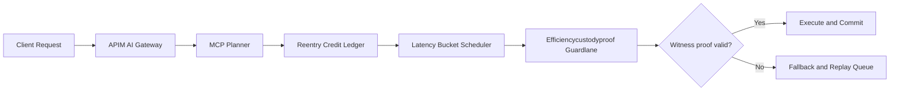

# Agent APIM/MCP 重入信用与延迟桶见证托管闭环证明护栏选型 FAQ（Cycle 2358）

## 1) 场景与约束
本轮聚焦 efficiencycustodyproof guardlane（见证托管闭环证明护栏）：在 APIM AI Gateway、MCP 工具编排、重入信用账本与延迟桶调度链路中，要求系统在突发重试与回放阶段保持见证链一致且可追责。

## 2) Q1 / Q2 / Q3
Q1：见证托管闭环与普通审计日志有什么区别？  
A1：见证托管要求每次重入决策都附带可重放证明，不仅记录事件，还要保证可验证因果链。

Q2：为何必须将见证证明与重入信用绑定？  
A2：信用扣减与恢复是流量闸门核心动作，若不绑定见证证明，后续无法解释回退或放行依据。

Q3：怎样控制证明开销？  
A3：热路径仅校验 proof_hash 与 witness_token，冷路径再做完整证据拼接与跨租户一致性比对。

## 3) 选型建议（Good fit / Not for）
Good fit：多租户 SaaS Agent Gateway、Browser/CUA 集群、高合规金融零信任执行环境。  
Not for：一次性离线脚本、无租户隔离诉求的小规模实验、无需重放追责的临时流程。

## 4) 可复现实验范围
实验数据见 `evidence/cycle-2358-benchmark.json`，覆盖冷启动/热恢复 P50/P95、并发吞吐、策略拦截率、单会话成本，并标注 measured/synthetic/anonymized_reported。

## 5) 百分比契约绑定（N/D）
- `percentage_contract.unfenced_reentry_efficiencycustodyproofguardlane_drift_rate`
- `percentage_contract.reentry_efficiencycustodyproofguardlane_variance_rate`
- `percentage_contract.reentry_efficiencycustodyproofguardlane_recovery_gain_pts`

以上键绑定本 FAQ 与 cycle-2358 证据，`production_validation=not_measured`。

## 6) 上线检查单
1. APIM 与 MCP 输出 proof_hash、witness_token、fallback_reason。
2. 重入信用写入 trace_id 与见证链摘要。
3. 延迟桶调度记录放行/回退判定来源。
4. 预算耗尽请求进入降级与回放队列。
5. 回放工具可按 trace_id 重构见证托管序列。
6. 日报保留 measured/synthetic/anonymized_reported 标签。
