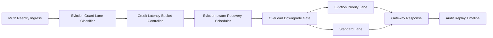

# APIM MCP 重入驱逐护栏延迟桶公平选型 FAQ（Cycle 2149）

## 1) 3 分钟结论
- **核心问题：** 重入高峰叠加会话驱逐时，延迟桶恢复顺序易出现跨租户偏斜。
- **推荐方案：** “驱逐护栏车道 + 延迟桶配给 + 分级降档 + 回放审计”闭环治理。
- **目标：** 在租户公平前提下，将驱逐窗口内的恢复抖振和回退影响面稳定在可控区间。

## 2) Q1 / Q2 / Q3
### Q1：为什么要引入 eviction guard lane？
1) 仅靠统一限流无法约束驱逐事件导致的突发偏斜；
2) 驱逐护栏可隔离高风险恢复路径并限制扩散；
3) 与延迟桶联动后可同时约束额度、时效、顺序与驱逐边界。

### Q2：生产分层怎么设计？
- **驱逐护栏层：** 按租户等级与驱逐风险映射恢复车道；
- **配给层：** 车道内发放延迟桶额度与续租窗口；
- **回收层：** 对超额租约执行窗口化回收并抑制抖振；
- **降档层：** 峰值触发分级降档并进入人工复盘队列。

### Q3：上线判据是什么？
- 无护栏漂移率持续下降；
- 驱逐车道方差率稳定且可追踪；
- 恢复收益（percentage points）跨窗口可复现。

## 3) 架构图

## 4) 选型矩阵
| 维度 | 统一延迟桶 | Eviction Guard Lane + Latency Bucket（推荐） |
|---|---:|---:|
| 驱逐期扩散控制 | 中 | 高 |
| 跨租户抖振抑制 | 中 | 高 |
| 驱逐回放可解释性 | 中 | 高 |
| 峰值降档稳定性 | 中 | 高 |
| 实施复杂度 | 中 | 中高 |

## 5) 数据证据与可复算算例（含 n 分母来源）
- 证据文件：
  - `workshops/azure-agent-infra/evidence/cycle-2149-benchmark.json`
  - `workshops/azure-agent-infra/evidence/cycle-2149-latency.csv`
  - `workshops/azure-agent-infra/evidence/cycle-2149-throughput.csv`
  - `workshops/azure-agent-infra/evidence/cycle-2149-cost.csv`
- 合同键：
  - `percentage_contract.unfenced_reentry_evictionguardlane_drift_rate`
  - `percentage_contract.reentry_evictionguardlane_variance_rate`
  - `percentage_contract.reentry_evictionguardlane_recovery_gain_pts`
- 标签：`measured / synthetic / anonymized_reported`。

## 6) 生产检查清单
- [ ] eviction 护栏映射规则可按租户等级重放。
- [ ] 延迟桶授予/续租/回收与驱逐护栏一致。
- [ ] 峰值降档时驱逐优先车道无饥饿。
- [ ] 审计链路可关联策略版本、驱逐等级与恢复轨迹。
- [ ] FAQ/H5/SVG/7-card/evidence 的 cycle/topic 一致。
