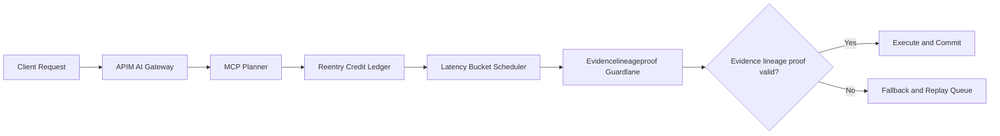

# Agent APIM/MCP Reentry Credit and Latency Bucket Evidence-Lineage-Proof Guardlane FAQ (Cycle 2299)

## 1) Context and constraints
This cycle focuses on evidencelineageproof guardlane design. APIM AI Gateway, MCP orchestration, reentry-credit ledgers, and latency-bucket scheduling must keep evidence lineage verifiable under burst and retry pressure.

## 2) Q1 / Q2 / Q3
Q1: How is evidence-lineage-proof guardlane different from audit-closure-proof guardlane?
A1: Audit-closure verifies auditable closure; evidence-lineage-proof verifies continuity of provenance from input to decision to writeback.

Q2: Why must this guardlane include reentry-credit ledgers?
A2: Reentry credit is the main lineage spine; missing lineage proof makes ledger evolution origin non-traceable.

Q3: How can evidence-lineage-proof checks stay efficient?
A3: Hot path checks lineage_hash and fallback_token, while cold path reconstructs full evidence graph offline.

## 3) Recommendation (Good fit / Not for)
Good fit: multi-tenant SaaS Agent Gateway, Browser/CUA clusters, and high-compliance zero-trust execution.
Not for: one-off scripts, temporary experiments without evidence-lineage-proof requirements, and single-node flows without tenant fairness constraints.

## 4) Reproducible benchmark scope
Evidence is in `evidence/cycle-2299-benchmark.json`, including cold/warm latency, throughput, policy interception, and per-session cost with measured/synthetic/anonymized_reported labels.

## 5) Percentage contract bindings (N/D)
- `percentage_contract.unfenced_reentry_evidencelineageproofguardlane_drift_rate`
- `percentage_contract.reentry_evidencelineageproofguardlane_variance_rate`
- `percentage_contract.reentry_evidencelineageproofguardlane_recovery_gain_pts`

These keys bind this FAQ to cycle-2299 evidence with `production_validation=not_measured`.

## 6) Production checklist
1. APIM and MCP emit lineage_hash and fallback_reason.
2. Reentry-credit writes include fallback_token and trace_id.
3. Latency-bucket decisions carry lineage-vote hash.
4. Budget-exhausted requests route to fallback and replay queues.
5. Replay tooling reconstructs evidence lineage by trace_id.
6. Reports preserve measured/synthetic/anonymized_reported labels.
