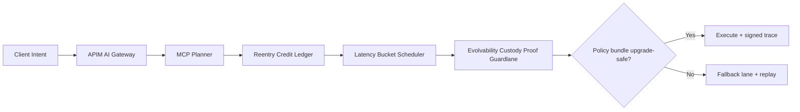

# Agent APIM/MCP Reentry Credit + Latency Bucket Evolvability Custody Proof Guardlane FAQ (Cycle 2366)

## 1) Scenario and constraints
This round focuses on **evolvabilitycustodyproof guardlane**: preserving deterministic proof custody while APIM policies, MCP orchestration rules, and reentry-credit controls evolve during continuous rollout.

## 2) Q1 / Q2 / Q3
Q1: Why prioritize evolvability instead of only verification?  
A1: Frequent policy updates can break replay continuity unless custody contracts remain version-aware and upgrade-safe.  

Q2: How does reentry credit stay consistent across policy versions?  
A2: Each retry records `policy_bundle_version`, `trace_anchor`, and `credit_delta`, so replay can reconstruct decisions under the exact version context.  

Q3: How do we limit cross-tenant side effects during upgrades?  
A3: Roll out via latency-bucket canaries; failed traffic is isolated into replay queues with tenant fairness metadata enforced.

## 3) Selection guidance (Good fit / Not for)
Good fit: multi-tenant SaaS agent gateways, Browser/CUA clusters, and high-compliance zero-trust finance execution lanes.  
Not for: static single-tenant scripts, short-lived experiments with no policy evolution, and workflows that do not require replay accountability.

## 4) Reproducible experiment scope
Evidence is in `evidence/cycle-2366-benchmark.json`, covering cold/warm latency P50/P95, concurrency throughput, interception rates, and per-session cost with measured/synthetic/anonymized_reported labels.

## 5) Percentage contract bindings (N/D)
- `percentage_contract.unfenced_reentry_evolvabilitycustodyproofguardlane_drift_rate`
- `percentage_contract.reentry_evolvabilitycustodyproofguardlane_variance_rate`
- `percentage_contract.reentry_evolvabilitycustodyproofguardlane_recovery_gain_pts`

These keys bind this FAQ to cycle-2366 evidence, with `production_validation=not_measured`.

## 6) Production checklist
1. APIM emits bundle_version, proof_signature, and fallback_reason.  
2. MCP logs exact policy-version transition points.  
3. Reentry ledger stores trace_anchor and credit_delta provenance.  
4. Latency-bucket canary failures are isolated in replay queues.  
5. Replay tooling reconstructs custody chains by trace_id + version.  
6. Report and card labels remain aligned with measured/synthetic/anonymized_reported.  
