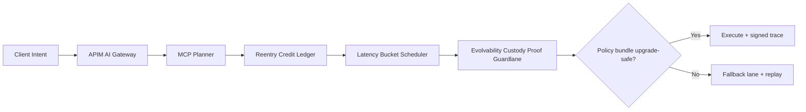

# Agent APIM/MCP 重入信用与延迟桶可演进托管证明护栏选型 FAQ（Cycle 2366）

## 1) 场景与约束
本轮聚焦 **evolvabilitycustodyproof guardlane**：目标是在 APIM AI Gateway、MCP 编排、重入信用账本与延迟桶调度链路中，保证策略迭代时仍可维持可追溯、可回放、可审计的一致证明链。

## 2) Q1 / Q2 / Q3
Q1：为什么强调“可演进”而不只是“可验证”？  
A1：因为夜班策略会高频迭代，若护栏不可演进，每次发布都可能打断重放链与追责链。  

Q2：如何让重入信用与版本演进同时成立？  
A2：每次重入动作附带 `policy_bundle_version` 与 `trace_anchor`，账本记录 credit_delta 与版本元数据，回放时按版本组合还原。  

Q3：演进后怎样抑制跨租户副作用？  
A3：演进前先在延迟桶灰度，失败流量进入隔离回放队列，并用 tenant fairness 标签约束恢复顺序。

## 3) 选型建议（Good fit / Not for）
Good fit：多租户 SaaS Agent Gateway、Browser/CUA 集群、高合规金融零信任执行环境。  
Not for：单租户静态脚本、无策略迭代需求的短期实验、无需回放追责的临时任务。

## 4) 可复现实验范围
证据文件 `evidence/cycle-2366-benchmark.json` 覆盖冷启动/热恢复 P50/P95、并发吞吐、策略拦截率、单会话成本，且统一标记 measured/synthetic/anonymized_reported。

## 5) 百分比契约绑定（N/D）
- `percentage_contract.unfenced_reentry_evolvabilitycustodyproofguardlane_drift_rate`
- `percentage_contract.reentry_evolvabilitycustodyproofguardlane_variance_rate`
- `percentage_contract.reentry_evolvabilitycustodyproofguardlane_recovery_gain_pts`

以上键与本 FAQ 及 cycle-2366 证据一一绑定，`production_validation=not_measured`。

## 6) 上线检查单
1. APIM 输出 bundle_version、proof_signature、fallback_reason。  
2. MCP 日志记录策略版本切换时间点。  
3. 重入信用账本写入 trace_anchor 与 credit_delta 来源。  
4. 延迟桶灰度失败请求进入 replay 隔离队列。  
5. 回放工具可按 trace_id + version 重建证明链。  
6. 日报与卡组标签保持 measured/synthetic/anonymized_reported 一致。  
