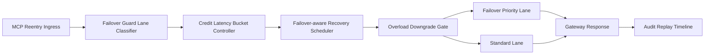

# APIM MCP Reentry Failover Guard Lane Latency Bucket FAQ (Cycle 2148)

## 1) Three-minute decision
- **Core issue:** under reentry peaks with multi-region failover, latency-bucket recovery order can become imbalanced.
- **Recommendation:** deploy a closed loop of failover guard lanes, latency-bucket allocation, tiered downgrade gates, and audit replay.
- **Goal:** preserve tenant fairness while keeping failover-window recovery throughput and explainability.

## 2) Q1 / Q2 / Q3
### Q1: Why add a failover guard lane?
1) standard throttling cannot fully cover cross-region failover skew,
2) failover lanes protect critical tenant recovery first,
3) with latency buckets, capacity, validity, order, and failover boundaries are jointly controlled.

### Q2: How should production layering work?
- **Failover guard layer:** map tenant class + region status to recovery lanes,
- **Allocation layer:** issue lane-scoped bucket credit and renewal windows,
- **Reclaim layer:** reclaim overdraft leases with anti-oscillation windows,
- **Downgrade layer:** trigger tiered downgrade and human replay queue during peaks.

### Q3: What is the go-live bar?
- unfenced drift rate keeps declining,
- failover-lane variance remains stable and traceable,
- recovery gain (percentage points) stays reproducible across windows.

## 3) Reference architecture

## 4) Decision matrix
| Dimension | Unified latency bucket | Failover Guard Lane + Latency Bucket (Recommended) |
|---|---:|---:|
| Failover-time propagation control | Medium | High |
| Cross-tenant jitter suppression | Medium | High |
| Failover replay explainability | Medium | High |
| Peak downgrade stability | Medium | High |
| Implementation complexity | Medium | Medium-High |

## 5) Evidence and reproducibility
- Evidence files:
  - `workshops/azure-agent-infra/evidence/cycle-2148-benchmark.json`
  - `workshops/azure-agent-infra/evidence/cycle-2148-latency.csv`
  - `workshops/azure-agent-infra/evidence/cycle-2148-throughput.csv`
  - `workshops/azure-agent-infra/evidence/cycle-2148-cost.csv`
- Contract keys:
  - `percentage_contract.unfenced_reentry_failoverguardlane_drift_rate`
  - `percentage_contract.reentry_failoverguardlane_variance_rate`
  - `percentage_contract.reentry_failoverguardlane_recovery_gain_pts`
- Labels: `measured / synthetic / anonymized_reported`.

## 6) Production checklist
- [ ] Failover-lane classification is tenant-class replayable.
- [ ] Bucket grant/renew/reclaim is failover-lane consistent.
- [ ] Failover-priority lanes stay starvation-free during peak downgrade.
- [ ] Audit trails bind policy version, failover class, and recovery path.
- [ ] FAQ/H5/SVG/7-card/evidence stay cycle-topic consistent.
