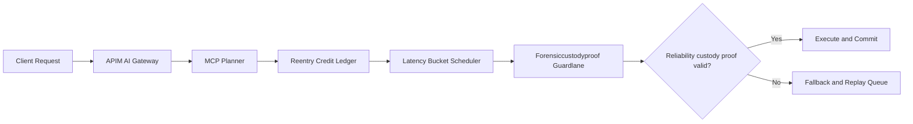

# Agent APIM/MCP 重入信用与延迟桶取证托管闭环证明护栏选型 FAQ（Cycle 2326）

## 1) 场景与约束
本轮聚焦 forensiccustodyproof guardlane（取证托管闭环证明护栏）：在 APIM AI Gateway、MCP 工具编排、重入信用账本与延迟桶调度链路中，要求系统在突发、重试与回放阶段保持取证托管闭环可验证。

## 2) Q1 / Q2 / Q3
Q1：取证托管闭环证明护栏与稳定性托管闭环证明护栏差异？
A1：稳定性托管强调长窗口波动约束，取证托管闭环强调 SLA 成功率、重试一致性与取证交付问责可核验。

Q2：为何取证托管闭环必须绑定重入信用账本？
A2：重入信用扣减与恢复需要可靠性锚点，缺失闭环会导致账本 SLA 追责断链。

Q3：如何控制取证托管闭环校验开销？
A3：热路径仅校验 forensic_custody_hash 与 fallback_token，冷路径离线重建取证托管序列。

## 3) 选型建议（Good fit / Not for）
Good fit：多租户 SaaS Agent Gateway、Browser/CUA 集群、高合规零信任执行环境。
Not for：一次性脚本任务、无需取证托管闭环的临时实验、无租户公平约束的单机流程。

## 4) 可复现实验范围
实验数据见 `evidence/cycle-2326-benchmark.json`，覆盖冷启动/热恢复 P50/P95、并发吞吐、策略拦截率、单会话成本，并标注 measured/synthetic/anonymized_reported。

## 5) 百分比契约绑定（N/D）
- `percentage_contract.unfenced_reentry_forensiccustodyproofguardlane_drift_rate`
- `percentage_contract.reentry_forensiccustodyproofguardlane_variance_rate`
- `percentage_contract.reentry_forensiccustodyproofguardlane_recovery_gain_pts`

以上键绑定本 FAQ 与 cycle-2326 证据，`production_validation=not_measured`。

## 6) 上线检查单
1. APIM 与 MCP 输出 forensic_custody_hash 与 fallback_reason。
2. 重入信用写入记录 fallback_token 与 trace_id。
3. 延迟桶调度结果附加取证托管投票哈希。
4. 预算耗尽请求进入降级与回放队列。
5. 回放工具支持按 trace_id 重建取证托管判定序列。
6. 日报保留 measured/synthetic/anonymized_reported 标签。
