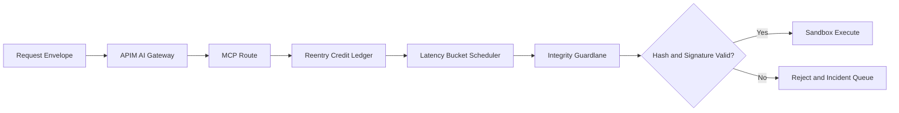

# Agent APIM/MCP Reentry Credit and Latency Bucket Integrity Guardlane FAQ (Cycle 2253)

## 1) Context and constraints
This cycle targets integrity guardlane design. In APIM AI Gateway plus MCP orchestration, reentry-credit ledger entries, latency-bucket decisions, and tool-call logs must remain hash-aligned and tamper-evident.

## 2) Q1 / Q2 / Q3
Q1: Is integrity guardrail redundant with provenance guardrail?
A1: No. Provenance validates source trust, integrity validates untampered transmission and state continuity.

Q2: Why validate integrity before execution?
A2: Post-execution tamper detection is too late for multi-tenant side effects.

Q3: How much latency overhead does integrity checking add?
A3: Hot-path hash and signature checks remain millisecond-scale; deep review is asynchronous.

## 3) Recommendation (Good fit / Not for)
Good fit: regulated financial workloads, multi-tenant SaaS Agent Gateway, and coding agents requiring non-repudiable audit trails.
Not for: one-off offline scripts without shared state or audit obligations.

## 4) Reproducible benchmark scope
Evidence is in `evidence/cycle-2253-benchmark.json`, covering cold/warm latency, throughput, policy interception, and per-session cost with explicit labels.

## 5) Percentage contract bindings (N/D)
- `percentage_contract.unfenced_reentry_integrityguardlane_drift_rate`
- `percentage_contract.reentry_integrityguardlane_variance_rate`
- `percentage_contract.reentry_integrityguardlane_recovery_gain_pts`

All keys bind to this FAQ and cycle-2253 evidence with `production_validation=not_measured`.

## 6) Production checklist
1. APIM policies emit policy_hash, payload_hash, and signature_id.
2. MCP routing logs align with gateway logs via trace_id plus hash.
3. Reentry-credit ledger writes are integrity-checked pre and post commit.
4. Failed checks route to incident and human-review queue.
5. Replay tooling reconstructs signature and hash chains end to end.
6. Reports preserve measured/synthetic/anonymized_reported labels.
