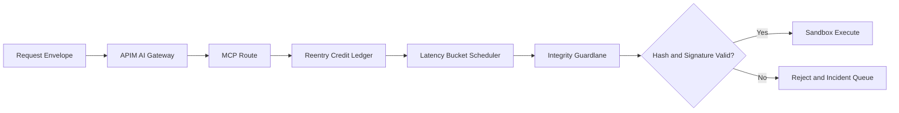

# Agent APIM/MCP 重入信用与延迟桶完整性护栏选型 FAQ（Cycle 2253）

## 1) 场景与约束
本轮聚焦 integrity guardlane（完整性护栏）：在 APIM AI Gateway + MCP 生产编排中，确保重入信用账本、延迟桶调度决策、工具调用日志三者的一致哈希可对齐，防止“账面通过但执行被篡改”。

## 2) Q1 / Q2 / Q3
Q1：完整性护栏与来源护栏是否重复？
A1：来源护栏解决“证据来源是否可信”，完整性护栏解决“证据在传递中是否被篡改”，两者互补且不可替代。

Q2：为何完整性校验放在执行前？
A2：执行后发现篡改往往已造成跨租户影响，前置校验能把风险止损在策略层。

Q3：完整性校验会增加多少延迟？
A3：热路径仅做哈希比对与签名验证，增量通常在毫秒级；复杂复核走异步冷路径。

## 3) 选型建议（Good fit / Not for）
Good fit：高合规金融、跨区多租户 SaaS Agent Gateway、要求审计不可抵赖的 Coding Agent。
Not for：一次性离线任务、无共享状态、无审计要求的实验脚本。

## 4) 可复现实验范围
实验口径见 `evidence/cycle-2253-benchmark.json`，覆盖冷启动/热恢复、并发吞吐、策略拦截率、单会话成本；所有百分比按 N/D 复算并标注来源标签。

## 5) 百分比契约绑定（N/D）
- `percentage_contract.unfenced_reentry_integrityguardlane_drift_rate`
- `percentage_contract.reentry_integrityguardlane_variance_rate`
- `percentage_contract.reentry_integrityguardlane_recovery_gain_pts`

以上键绑定到本 FAQ 与 cycle-2253 证据集，`production_validation=not_measured`。

## 6) 上线检查单
1. APIM 策略输出 policy_hash、payload_hash、signature_id。
2. MCP 路由日志与网关日志可按 trace_id + hash 对齐。
3. 重入信用账本写入前后均做完整性校验。
4. 校验失败请求进入告警与人工复核队列。
5. 回放工具能重建完整签名链与哈希链。
6. 周期报告保留 measured/synthetic/anonymized_reported 标签。
