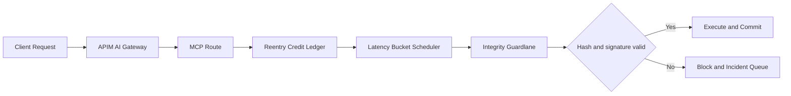

# Agent APIM/MCP Reentry Credit and Latency Bucket Integrity Guardlane FAQ (Cycle 2258)

## 1) Context and constraints
This cycle targets integrity guardlane design. APIM AI Gateway and MCP orchestration require hash- and signature-based verification across reentry-credit ledgers, latency-bucket scheduling, and tool execution outputs before commit.

## 2) Q1 / Q2 / Q3
Q1: How does integrity differ from consistency?
A1: Consistency checks replica convergence, while integrity checks tamper resistance in transit and persistence.

Q2: Why verify integrity both pre and post commit?
A2: Pre-check blocks dirty writes; post-check confirms final state matches executed output.

Q3: How do we limit overhead under peak load?
A3: Keep hot path at summary-hash and signature-fingerprint checks, then run deep verification asynchronously.

## 3) Recommendation (Good fit / Not for)
Good fit: regulated finance, cross-team operations, multi-tenant SaaS Agent Gateway.
Not for: short offline scripts without shared-state or audit obligations.

## 4) Reproducible benchmark scope
Evidence is in `evidence/cycle-2258-benchmark.json`, including cold/warm latency, throughput, policy interception, and session cost with N/D-derived percentages.

## 5) Percentage contract bindings (N/D)
- `percentage_contract.unfenced_reentry_integrityguardlane_drift_rate`
- `percentage_contract.reentry_integrityguardlane_variance_rate`
- `percentage_contract.reentry_integrityguardlane_recovery_gain_pts`

These keys bind to this FAQ and cycle-2258 evidence with `production_validation=not_measured`.

## 6) Production checklist
1. APIM and MCP emit payload_hash, policy_hash, and signature_id.
2. Reentry-credit writes keep hash_before/hash_after records.
3. Latency-bucket decisions carry signature version metadata.
4. Failed verification routes to block and incident queue.
5. Replay tooling reconstructs end-to-end signature chain.
6. Reports preserve measured/synthetic/anonymized_reported labels.
