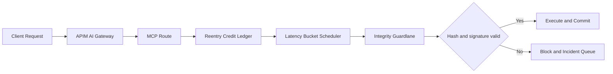

# Agent APIM/MCP 重入信用与延迟桶完整性护栏选型 FAQ（Cycle 2263）

## 1) 场景与约束
本轮聚焦 integrity guardlane：在 APIM AI Gateway 与 MCP 编排链路中，要求重入信用账本、延迟桶调度、工具调用结果三者在每次提交前具备一致哈希与签名校验，防止“状态被改写但流程继续放行”。

## 2) Q1 / Q2 / Q3
Q1：完整性护栏与一致性护栏如何分工？
A1：一致性护栏关注多副本是否同构，完整性护栏关注数据是否在传输和落盘过程中被篡改。

Q2：为什么完整性校验要在提交前后都做？
A2：提交前校验阻断脏数据，提交后校验确保最终落盘状态与执行结果一致。

Q3：完整性校验如何不拖慢高峰吞吐？
A3：热路径只校验摘要哈希与签名指纹，深度校验放到异步冷路径。

## 3) 选型建议（Good fit / Not for）
Good fit：高合规金融、跨团队协作、多租户 SaaS Agent Gateway。
Not for：短时离线脚本、无共享状态、无审计要求的任务。

## 4) 可复现实验范围
实验口径见 `evidence/cycle-2263-benchmark.json`，包含冷启动/热恢复、吞吐、策略拦截率、单会话成本；所有百分比按 N/D 复算并标注来源标签。

## 5) 百分比契约绑定（N/D）
- `percentage_contract.unfenced_reentry_integrityguardlane_drift_rate`
- `percentage_contract.reentry_integrityguardlane_variance_rate`
- `percentage_contract.reentry_integrityguardlane_recovery_gain_pts`

以上键绑定本 FAQ 与 cycle-2263 证据，`production_validation=not_measured`。

## 6) 上线检查单
1. APIM 与 MCP 输出 payload_hash、policy_hash、signature_id。
2. 重入信用写入记录 hash_before/hash_after。
3. 延迟桶调度结果携带签名版本号。
4. 校验失败请求进入阻断与排障队列。
5. 回放工具可重建端到端签名链。
6. 报告保留 measured/synthetic/anonymized_reported 标签。
