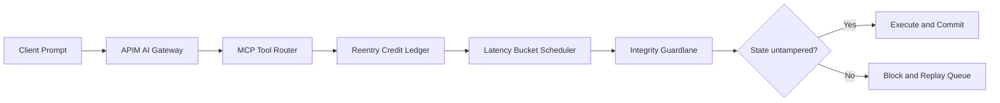

# Agent APIM/MCP Reentry Credit and Latency Bucket Integrity Guardlane FAQ (Cycle 2273)

## 1) Context and constraints
This cycle focuses on integrity guardlane design. APIM AI Gateway, MCP orchestration, reentry-credit ledgers, and latency-bucket scheduling must preserve tamper-evident state and policy context.

## 2) Q1 / Q2 / Q3
Q1: How is integrity different from provenance?
A1: Provenance verifies where evidence originates; integrity verifies that evidence and state were not altered.

Q2: Why must integrity checks include reentry-credit ledgers?
A2: Reentry credit is cumulative cross-request state, so tampering propagates to later scheduling decisions.

Q3: How can integrity checks stay fast?
A3: Hot path validates hash/signature summaries, while cold path performs full recomputation and sampled audits.

## 3) Recommendation (Good fit / Not for)
Good fit: multi-tenant SaaS Agent Gateway, zero-trust financial execution, and audit-heavy production clusters.
Not for: one-off offline scripts, stateless prototypes, and ungated experimental traffic.

## 4) Reproducible benchmark scope
Evidence is in `evidence/cycle-2273-benchmark.json`, including cold/warm latency, throughput, policy interception, and per-session cost with measured/synthetic/anonymized_reported labels.

## 5) Percentage contract bindings (N/D)
- `percentage_contract.unfenced_reentry_integrityguardlane_drift_rate`
- `percentage_contract.reentry_integrityguardlane_variance_rate`
- `percentage_contract.reentry_integrityguardlane_recovery_gain_pts`

These keys bind this FAQ to cycle-2273 evidence with `production_validation=not_measured`.

## 6) Production checklist
1. APIM and MCP emit state_hash and policy_hash.
2. Reentry-credit writes include signature version and trace_id.
3. Latency-bucket decisions carry immutable hash fingerprints.
4. Failed checks route to block and replay queues.
5. Replay tooling recomputes integrity chains by trace_id.
6. Reports preserve measured/synthetic/anonymized_reported labels.
