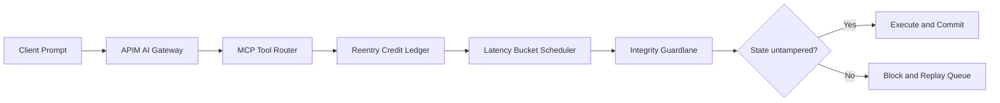

# Agent APIM/MCP 重入信用与延迟桶完整性护栏选型 FAQ（Cycle 2273）

## 1) 场景与约束
本轮聚焦 integrity guardlane（完整性护栏）：在 APIM AI Gateway、MCP 工具编排、重入信用账本、延迟桶调度联动路径中，要求关键状态与策略上下文不可被无签名修改，防止“结果可达但中间状态被污染”。

## 2) Q1 / Q2 / Q3
Q1：完整性护栏与来源护栏边界？
A1：来源护栏回答“证据从哪来”，完整性护栏回答“证据和状态是否被篡改”。

Q2：为什么完整性必须覆盖重入信用账本？
A2：重入信用是跨请求累积资产，任何篡改都会在后续调度中放大风险。

Q3：完整性校验如何不拖慢热路径？
A3：热路径校验哈希与签名摘要，冷路径做全量重算与审计抽查。

## 3) 选型建议（Good fit / Not for）
Good fit：多租户 SaaS Agent Gateway、零信任金融执行环境、高审计密度生产集群。
Not for：一次性离线脚本、无状态原型、无需治理追责的实验流量。

## 4) 可复现实验范围
实验数据见 `evidence/cycle-2273-benchmark.json`，覆盖冷启动/热恢复 P50/P95、并发吞吐、策略拦截率、单会话成本，并标注 measured/synthetic/anonymized_reported。

## 5) 百分比契约绑定（N/D）
- `percentage_contract.unfenced_reentry_integrityguardlane_drift_rate`
- `percentage_contract.reentry_integrityguardlane_variance_rate`
- `percentage_contract.reentry_integrityguardlane_recovery_gain_pts`

以上键绑定本 FAQ 与 cycle-2273 证据，`production_validation=not_measured`。

## 6) 上线检查单
1. APIM 与 MCP 输出 state_hash 与 policy_hash。
2. 重入信用写入记录签名版本与 trace_id。
3. 延迟桶调度结果附带不可变哈希指纹。
4. 校验失败请求进入阻断与回放队列。
5. 回放工具支持按 trace_id 重算完整性链。
6. 日报保留 measured/synthetic/anonymized_reported 标签。
