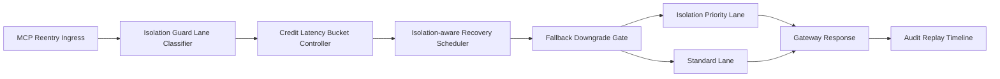

# APIM MCP Reentry Isolation Guard Lane Latency Bucket FAQ (Cycle 2156)

## 1) Three-minute decision
- **Core issue:** under reentry peaks plus policy oscillation, recovery paths show isolation imbalance and fairness decay.
- **Recommendation:** implement a closed loop of isolation guard lanes, latency-bucket allocation, fallback downgrade gates, and replay audit.
- **Goal:** preserve tenant fairness while shrinking propagation windows and rollback amplification.

## 2) Q1 / Q2 / Q3
### Q1: Why add an isolation guard lane?
1) unified throttling cannot separate isolation risk classes,
2) isolation lanes block lateral spread from high-risk sessions while protecting critical recovery paths,
3) with latency buckets, credit, validity, ordering, and isolation boundaries are jointly bounded.

### Q2: How should production layering work?
- **Isolation guard layer:** map tenant class + isolation state into recovery lanes,
- **Allocation layer:** issue lane-scoped bucket credit and renewal windows,
- **Reclaim layer:** reclaim overdraft leases with anti-propagation windows,
- **Downgrade layer:** trigger fallback downgrade and human replay at peak.

### Q3: What is the go-live bar?
- unfenced drift keeps declining,
- guard-lane variance remains stable and traceable,
- recovery gain (percentage points) stays reproducible across windows.

## 3) Reference architecture

## 4) Decision matrix
| Dimension | Unified latency bucket | Isolation Guard Lane + Latency Bucket (Recommended) |
|---|---:|---:|
| Isolation drift control | Medium | High |
| Cross-tenant propagation suppression | Medium | High |
| Replay explainability | Medium | High |
| Peak downgrade stability | Medium | High |
| Implementation complexity | Medium | Medium-High |

## 5) Evidence and reproducibility
- Evidence files:
  - `workshops/azure-agent-infra/evidence/cycle-2156-benchmark.json`
  - `workshops/azure-agent-infra/evidence/cycle-2156-latency.csv`
  - `workshops/azure-agent-infra/evidence/cycle-2156-throughput.csv`
  - `workshops/azure-agent-infra/evidence/cycle-2156-cost.csv`
- Contract keys:
  - `percentage_contract.unfenced_reentry_isolationguardlane_drift_rate`
  - `percentage_contract.reentry_isolationguardlane_variance_rate`
  - `percentage_contract.reentry_isolationguardlane_recovery_gain_pts`
- Labels: `measured / synthetic / anonymized_reported`.

## 6) Production checklist
- [ ] Isolation-lane classification is tenant-class replayable.
- [ ] Bucket grant/renew/reclaim is isolation-lane consistent.
- [ ] Isolation-priority lanes stay starvation-free during peak downgrade.
- [ ] Audit trails bind policy version, isolation class, and recovery path.
- [ ] FAQ/H5/SVG/7-card/evidence stay cycle-topic consistent.
