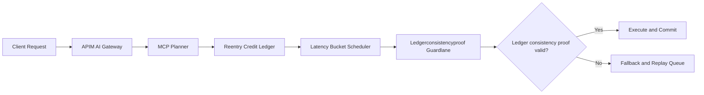

# Agent APIM/MCP Reentry Credit and Latency Bucket Ledger-Consistency-Proof Guardlane FAQ (Cycle 2293)

## 1) Context and constraints
This cycle focuses on ledgerconsistencyproof guardlane design. APIM AI Gateway, MCP orchestration, reentry-credit ledgers, and latency-bucket scheduling must keep ledger consistency verifiable under burst and retry pressure.

## 2) Q1 / Q2 / Q3
Q1: How is ledger-consistency-proof guardlane different from reconciliation-proof guardlane?
A1: Reconciliation validates final matching; ledger-consistency-proof enforces stage-by-stage state evolution traceability.

Q2: Why must this guardlane include reentry-credit ledgers?
A2: Reentry credit defines budget and ordering, so missing consistency proof causes drift between budget ledgers and execution state.

Q3: How can consistency-proof checks stay efficient?
A3: Hot path checks ledger_consistency_hash and fallback_token, while cold path replays full ledger evolution offline.

## 3) Recommendation (Good fit / Not for)
Good fit: multi-tenant SaaS Agent Gateway, Browser/CUA clusters, and high-compliance zero-trust execution.
Not for: one-off scripts, temporary experiments without ledger-consistency-proof requirements, and single-node flows without tenant fairness constraints.

## 4) Reproducible benchmark scope
Evidence is in `evidence/cycle-2293-benchmark.json`, including cold/warm latency, throughput, policy interception, and per-session cost with measured/synthetic/anonymized_reported labels.

## 5) Percentage contract bindings (N/D)
- `percentage_contract.unfenced_reentry_ledgerconsistencyproofguardlane_drift_rate`
- `percentage_contract.reentry_ledgerconsistencyproofguardlane_variance_rate`
- `percentage_contract.reentry_ledgerconsistencyproofguardlane_recovery_gain_pts`

These keys bind this FAQ to cycle-2293 evidence with `production_validation=not_measured`.

## 6) Production checklist
1. APIM and MCP emit ledger_consistency_hash and fallback_reason.
2. Reentry-credit writes include fallback_token and trace_id.
3. Latency-bucket decisions carry consistency-vote hash.
4. Budget-exhausted requests route to fallback and replay queues.
5. Replay tooling reconstructs ledger evolution by trace_id.
6. Reports preserve measured/synthetic/anonymized_reported labels.
