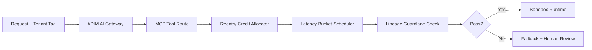

# Agent APIM/MCP Reentry Credit and Latency Bucket Lineage Guardlane FAQ (Cycle 2251)

## 1) Context and constraints
This cycle introduces a lineage guardlane for multi-tenant Agent Gateway scheduling. The design goal is to keep reentry-credit and latency-bucket execution auditable and replayable without cross-tenant lineage contamination.

## 2) Q1 / Q2 / Q3
Q1: Why run lineage checks after latency bucket assignment?
A1: Budgeting first prevents early hard-reject cascades that inflate tail latency under burst traffic.

Q2: How is lineage different from consistency guardrails?
A2: Consistency asks whether state snapshots match; lineage asks whether state history remains attributable and replayable.

Q3: How do we avoid lineage-check hotspots?
A3: Charge lineage verification cost into reentry credit and degrade to a low-cost review lane when the credit floor is hit.

## 3) Recommendation (Good fit / Not for)
Good fit: regulated financial workloads, cross-region audit trails, coding agents with strict provenance requirements.
Not for: single-tenant short-lived experiments focused purely on minimum latency.

## 4) Reproducible benchmark scope
Benchmark baseline is in `evidence/cycle-2251-benchmark.json`, including cold/warm latency, throughput, policy interception, and per-session cost with deterministic N/D-derived percentages.

## 5) Percentage contract bindings (N/D)
- `percentage_contract.unfenced_reentry_lineageguardlane_drift_rate`
- `percentage_contract.reentry_lineageguardlane_variance_rate`
- `percentage_contract.reentry_lineageguardlane_recovery_gain_pts`

All keys are bound to this FAQ and cycle-2251 evidence with `production_validation=not_measured`.

## 6) Production checklist
1. APIM policies include tenant tag, lineage tag, and request hash.
2. MCP route logs join with gateway logs by trace_id.
3. Reentry-credit overdraft triggers deterministic fallback.
4. Lineage rejects route to human review queue.
5. Source labels remain explicit: measured/synthetic/anonymized_reported.
6. Rollback flow never reuses cross-tenant cache entries.
