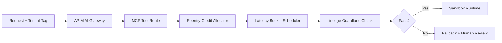

# Agent APIM/MCP 重入信用与延迟桶系谱护栏选型 FAQ（Cycle 2251）

## 1) 场景与约束
我们在多租户 Agent Gateway 中引入系谱护栏（lineage guardlane），目标是在重入信用（reentry credit）与延迟桶（latency bucket）并行调度时，保证审计链条可回放且不跨租户串链。生产约束是：租户隔离优先、回放链完整优先、再追求吞吐最优。

## 2) Q1 / Q2 / Q3
Q1：为何把系谱护栏放在延迟桶之后？
A1：先完成预算分配，再做系谱一致性裁决，可避免先验拒绝导致的长尾放大。

Q2：系谱护栏与一致性护栏有什么边界？
A2：一致性护栏关注“状态是否同构”，系谱护栏关注“状态从何而来、能否追溯”。二者可叠加，但告警维度应分离。

Q3：如何避免租户热点把系谱校验压穿？
A3：把校验成本并入重入信用扣减，超过阈值直接降级到低成本路径并打标待复核。

## 3) 决策建议（Good fit / Not for）
Good fit：金融高合规、跨区域审计、需要链路追溯的 Coding Agent。
Not for：单租户短生命周期实验环境、仅追求极限低延迟且不做审计沉淀的场景。

## 4) 可复现实验口径
实验基线见 `evidence/cycle-2251-benchmark.json`，关键指标包括冷启动/热池恢复、并发吞吐、策略拦截率、单会话成本。所有百分比以分子/分母复算到 0.1 精度。

## 5) 百分比契约绑定（N/D）
- `percentage_contract.unfenced_reentry_lineageguardlane_drift_rate`
- `percentage_contract.reentry_lineageguardlane_variance_rate`
- `percentage_contract.reentry_lineageguardlane_recovery_gain_pts`

以上键均绑定到本文件与 cycle-2251 证据集，`production_validation=not_measured`。

## 6) 上线检查单
1. APIM 策略链含 tenant tag、lineage tag、request hash。
2. MCP 路由日志与网关日志可按 trace_id 拼接。
3. 重入信用透支触发降级且可观测。
4. 系谱护栏拒绝路径进入人工复核队列。
5. 周期复盘记录保留来源标签：measured/synthetic/anonymized_reported。
6. 发生回退时保证跨租户缓存不复用。
