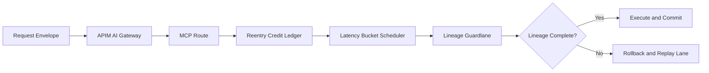

# Agent APIM/MCP 重入信用与延迟桶系谱护栏选型 FAQ（Cycle 2256）

## 1) 场景与约束
本轮聚焦 lineage guardlane（系谱护栏）：要求 APIM AI Gateway、MCP 工具编排、重入信用账本、延迟桶调度在跨阶段传递时保持可追溯系谱链，避免“当前状态正确但历史来源断裂”。

## 2) Q1 / Q2 / Q3
Q1：系谱护栏与来源护栏有什么区别？
A1：来源护栏校验“证据是否可信”，系谱护栏校验“证据在多阶段是否连续可追踪”。

Q2：为什么系谱检查必须覆盖重入信用账本？
A2：重入信用是跨请求累积状态，任何链条断裂都会放大后续调度偏差。

Q3：系谱校验怎样降低性能开销？
A3：热路径只验 lineage_id 与 parent_id 摘要，冷路径按采样做全链重放核对。

## 3) 选型建议（Good fit / Not for）
Good fit：多租户 SaaS Agent Gateway、需要审计重放、跨团队排障协同的生产环境。
Not for：一次性离线脚本、无状态短任务、无审计追责场景。

## 4) 可复现实验范围
实验基线见 `evidence/cycle-2256-benchmark.json`，覆盖冷启动/热恢复、吞吐、策略拦截率、单会话成本；百分比按 N/D 复算并标注来源标签。

## 5) 百分比契约绑定（N/D）
- `percentage_contract.unfenced_reentry_lineageguardlane_drift_rate`
- `percentage_contract.reentry_lineageguardlane_variance_rate`
- `percentage_contract.reentry_lineageguardlane_recovery_gain_pts`

以上键绑定本 FAQ 与 cycle-2256 证据集，`production_validation=not_measured`。

## 6) 上线检查单
1. APIM 与 MCP 输出 lineage_id、parent_lineage_id。
2. 重入信用写入记录 lineage hop 序号。
3. 延迟桶调度决策附带 lineage 快照哈希。
4. 链条断裂请求进入回滚与重放队列。
5. 回放工具可按 trace_id 复原 lineage DAG。
6. 报告保留 measured/synthetic/anonymized_reported 标签。
