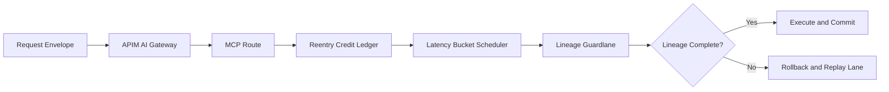

# Agent APIM/MCP Reentry Credit and Latency Bucket Lineage Guardlane FAQ (Cycle 2266)

## 1) Context and constraints
This cycle focuses on lineage guardlane design. APIM AI Gateway, MCP orchestration, reentry-credit ledgers, and latency-bucket scheduling must preserve a continuous lineage chain across execution stages.

## 2) Q1 / Q2 / Q3
Q1: How is lineage different from provenance?
A1: Provenance validates source trust; lineage validates stage-to-stage continuity and replayability.

Q2: Why must lineage checks include reentry-credit ledgers?
A2: Reentry credit is cumulative state, so one chain break propagates scheduling bias downstream.

Q3: How do we contain lineage-check overhead?
A3: Hot path verifies lineage_id and parent_id summaries, while cold path performs sampled full-chain replay.

## 3) Recommendation (Good fit / Not for)
Good fit: multi-tenant SaaS Agent Gateway, replay-heavy incident analysis, cross-team production operations.
Not for: one-off offline scripts and short stateless tasks without audit obligations.

## 4) Reproducible benchmark scope
Evidence is in `evidence/cycle-2266-benchmark.json`, including cold/warm latency, throughput, policy interception, and per-session cost with N/D-derived percentages.

## 5) Percentage contract bindings (N/D)
- `percentage_contract.unfenced_reentry_lineageguardlane_drift_rate`
- `percentage_contract.reentry_lineageguardlane_variance_rate`
- `percentage_contract.reentry_lineageguardlane_recovery_gain_pts`

These keys bind to this FAQ and cycle-2266 evidence with `production_validation=not_measured`.

## 6) Production checklist
1. APIM and MCP emit lineage_id and parent_lineage_id.
2. Reentry-credit writes record lineage hop sequence.
3. Latency-bucket decisions include lineage snapshot hash.
4. Broken chains route to rollback and replay queue.
5. Replay tooling reconstructs lineage DAG by trace_id.
6. Reports preserve measured/synthetic/anonymized_reported labels.
