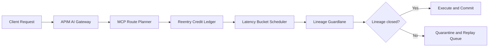

# Agent APIM/MCP Reentry Credit and Latency Bucket Lineage Guardlane FAQ (Cycle 2271)

## 1) Context and constraints
This cycle focuses on lineage guardlane continuity. APIM AI Gateway, MCP orchestration, reentry-credit ledgers, and latency-bucket scheduling must preserve verifiable lineage links at every hop.

## 2) Q1 / Q2 / Q3
Q1: Why not verify lineage only at egress?
A1: Egress checks detect drift, but cannot localize the broken hop; staged checks keep blast radius small.

Q2: Is lineage guardlane redundant with consistency guardlane?
A2: Consistency validates converged current state; lineage validates the historical transition chain. They are complementary.

Q3: How can lineage checks stay cost-efficient?
A3: Hot path validates lineage_id + parent_id + hop_index summaries, while cold path replays sampled full chains.

## 3) Recommendation (Good fit / Not for)
Good fit: multi-tenant SaaS Agent Gateway, cross-region replay governance, production accountability workflows.
Not for: one-off offline scripts, stateless short tasks, and lightweight prototypes without traceability requirements.

## 4) Reproducible benchmark scope
Evidence is in `evidence/cycle-2271-benchmark.json`, including cold/warm latency, throughput, policy interception, and per-session cost with measured/synthetic/anonymized_reported labels.

## 5) Percentage contract bindings (N/D)
- `percentage_contract.unfenced_reentry_lineageguardlane_drift_rate`
- `percentage_contract.reentry_lineageguardlane_variance_rate`
- `percentage_contract.reentry_lineageguardlane_recovery_gain_pts`

These keys bind this FAQ to cycle-2271 evidence with `production_validation=not_measured`.

## 6) Production checklist
1. APIM and MCP emit lineage_id and parent_lineage_id.
2. Reentry-credit writes include hop_index and route_epoch.
3. Latency-bucket decisions carry lineage snapshot hash.
4. Any chain break routes traffic to quarantine and replay queue.
5. Replay tooling reconstructs lineage DAG by trace_id.
6. Reports preserve measured/synthetic/anonymized_reported labels.
