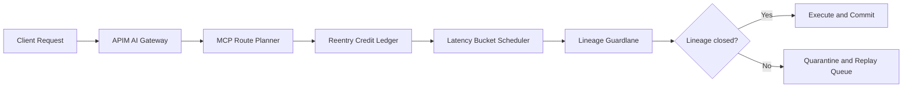

# Agent APIM/MCP 重入信用与延迟桶系谱护栏选型 FAQ（Cycle 2271）

## 1) 场景与约束
本轮聚焦 lineage guardlane（系谱护栏）的“跨阶段连续性”：要求 APIM AI Gateway、MCP 编排、重入信用账本、延迟桶调度在每一跳都保留可验证 lineage 关系，避免“当前指标正常但历史链条断层”。

## 2) Q1 / Q2 / Q3
Q1：为什么系谱护栏不能只在出口校验？
A1：出口校验只能发现“结果不一致”，无法定位哪一跳产生断裂；分段校验才能缩短排障路径。

Q2：系谱护栏与一致性护栏是否重复？
A2：一致性看“当前状态是否收敛”，系谱看“状态如何演化而来”；两者互补，不可替代。

Q3：如何压缩系谱校验成本？
A3：热路径只验证 lineage_id、parent_id、hop_index 三元摘要，冷路径按策略抽样回放整链。

## 3) 选型建议（Good fit / Not for）
Good fit：多租户 SaaS Agent Gateway、跨区域回放治理、需要责任归因的生产集群。
Not for：一次性离线任务、无状态脚本、无需链路追责的轻量原型。

## 4) 可复现实验范围
实验基线见 `evidence/cycle-2271-benchmark.json`，包含冷启动/热恢复 P50/P95、并发吞吐、策略拦截率、单会话成本，全部附带 measured/synthetic/anonymized_reported 标签。

## 5) 百分比契约绑定（N/D）
- `percentage_contract.unfenced_reentry_lineageguardlane_drift_rate`
- `percentage_contract.reentry_lineageguardlane_variance_rate`
- `percentage_contract.reentry_lineageguardlane_recovery_gain_pts`

以上键绑定本 FAQ 与 cycle-2271 证据，`production_validation=not_measured`。

## 6) 上线检查单
1. APIM 与 MCP 必须输出 lineage_id 与 parent_lineage_id。
2. 重入信用写入时记录 hop_index 与 route_epoch。
3. 延迟桶调度决策附带 lineage snapshot hash。
4. 任一链条缺段即进入隔离与回放队列。
5. 回放工具支持按 trace_id 还原 lineage DAG。
6. 日报保留 measured/synthetic/anonymized_reported 标签。
