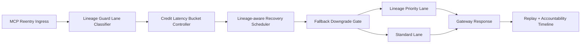

# APIM MCP Reentry Lineage Guard Lane Latency Bucket FAQ (Cycle 2169)

## 1) Three-minute decision
- **Core issue:** in reentry peak windows, misaligned policy lineage and execution mapping amplifies fairness jitter and rollback spread.
- **Recommendation:** run a closed loop of lineage guard lanes, latency-bucket allocation, fallback downgrade gates, and replay accountability.
- **Goal:** under multi-tenant fairness constraints, shrink lineage-drift windows and rollback amplification cost.

## 2) Q1 / Q2 / Q3
### Q1: Why add a lineage guard lane?
1) unified throttling cannot separate lineage trust classes,
2) lineage lanes isolate high-risk reentry flows during policy transitions,
3) with latency buckets, credit, ordering, and lineage consistency are bounded jointly.

### Q2: How should production layering work?
- **Lineage guard layer:** map tenant tier + lineage signature into recovery lanes,
- **Allocation layer:** manage lane-scoped bucket credit, renewal, and reclaim windows,
- **Reclaim layer:** reclaim overdraft leases while suppressing spread,
- **Downgrade layer:** trigger fallback downgrade at peak with accountable replay evidence.

### Q3: What is the go-live bar?
- unfenced lineage drift keeps shrinking,
- lane variance remains stable and explainable,
- recovery gain (percentage points) is reproducible across windows.

## 3) Reference architecture

## 4) Decision matrix
| Dimension | Unified latency bucket | Lineage Guard Lane + Latency Bucket (Recommended) |
|---|---:|---:|
| Lineage drift control | Medium | High |
| Cross-tenant propagation suppression | Medium | High |
| Replay accountability | Medium | High |
| Peak downgrade stability | Medium | High |
| Implementation complexity | Medium | Medium-High |

## 5) Evidence and reproducibility
- Evidence files:
  - `workshops/azure-agent-infra/evidence/cycle-2169-benchmark.json`
  - `workshops/azure-agent-infra/evidence/cycle-2169-latency.csv`
  - `workshops/azure-agent-infra/evidence/cycle-2169-throughput.csv`
  - `workshops/azure-agent-infra/evidence/cycle-2169-cost.csv`
- Contract keys:
  - `percentage_contract.unfenced_reentry_lineageguardlane_drift_rate`
  - `percentage_contract.reentry_lineageguardlane_variance_rate`
  - `percentage_contract.reentry_lineageguardlane_recovery_gain_pts`
- Labels: `measured / synthetic / anonymized_reported`.

## 6) Production checklist
- [ ] Lineage-lane mapping is tenant-tier replayable.
- [ ] Bucket grant/renew/reclaim is lineage-lane consistent.
- [ ] Lineage-priority lanes stay starvation-free during peak downgrade.
- [ ] Audit trails bind policy version, lineage signature, and recovery path.
- [ ] FAQ/H5/SVG/7-card/evidence stay cycle-topic consistent.
