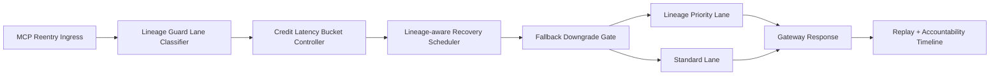

# APIM MCP 重入血缘护栏延迟桶公平选型 FAQ（Cycle 2169）

## 1) 3 分钟结论
- **核心问题：** 重入峰值窗口内，策略血缘与执行链映射错位会放大公平抖动与回退扩散。
- **推荐方案：** “血缘护栏车道 + 延迟桶配给 + 回退旁路 + 审计回放”闭环治理。
- **目标：** 在多租户公平约束下收敛血缘漂移窗口，并降低回退放大成本。

## 2) Q1 / Q2 / Q3
### Q1：为什么需要 lineage guard lane？
1) 统一限流无法识别血缘可信度分层；
2) 血缘护栏可在策略切换期隔离高风险重入流；
3) 与延迟桶协同后可联合控制额度、时序与血缘一致性。

### Q2：生产分层如何落地？
- **血缘护栏层：** 按租户等级与血缘签名映射恢复车道；
- **配给层：** 车道内管理延迟桶额度、续租与回收窗口；
- **回收层：** 对超额租约执行窗口化回收并抑制扩散；
- **降档层：** 峰值触发旁路降档并保留可追责回放证据。

### Q3：上线判据是什么？
- 无护栏血缘漂移率持续收敛；
- 血缘护栏车道方差率稳定且可解释；
- 恢复收益（percentage points）跨窗口可复算。

## 3) 架构图

## 4) 选型矩阵
| 维度 | 统一延迟桶 | Lineage Guard Lane + Latency Bucket（推荐） |
|---|---:|---:|
| 血缘漂移控制 | 中 | 高 |
| 跨租户扩散抑制 | 中 | 高 |
| 回放可追责性 | 中 | 高 |
| 峰值降档稳定性 | 中 | 高 |
| 实施复杂度 | 中 | 中高 |

## 5) 数据证据与可复算算例（含 n 分母来源）
- 证据文件：
  - `workshops/azure-agent-infra/evidence/cycle-2169-benchmark.json`
  - `workshops/azure-agent-infra/evidence/cycle-2169-latency.csv`
  - `workshops/azure-agent-infra/evidence/cycle-2169-throughput.csv`
  - `workshops/azure-agent-infra/evidence/cycle-2169-cost.csv`
- 合同键：
  - `percentage_contract.unfenced_reentry_lineageguardlane_drift_rate`
  - `percentage_contract.reentry_lineageguardlane_variance_rate`
  - `percentage_contract.reentry_lineageguardlane_recovery_gain_pts`
- 标签：`measured / synthetic / anonymized_reported`。

## 6) 生产检查清单
- [ ] lineage 护栏映射可按租户等级重放。
- [ ] 延迟桶授予/续租/回收与血缘护栏一致。
- [ ] 峰值降档时血缘优先车道无饥饿。
- [ ] 审计链路可关联策略版本、血缘签名与恢复轨迹。
- [ ] FAQ/H5/SVG/7-card/evidence 的 cycle/topic 一致。
