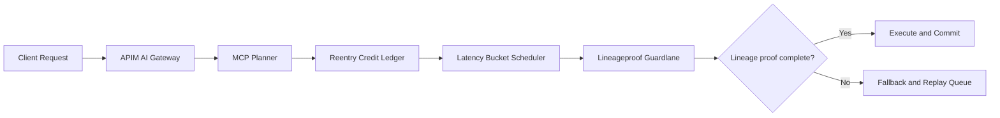

# Agent APIM/MCP Reentry Credit and Latency Bucket Lineage-Proof Guardlane FAQ (Cycle 2278)

## 1) Context and constraints
This cycle focuses on lineageproof guardlane design. APIM AI Gateway, MCP orchestration, reentry-credit ledgers, and latency-bucket scheduling must preserve verifiable lineage-proof chains under burst and retry pressure.

## 2) Q1 / Q2 / Q3
Q1: How is lineage-proof different from traceability?
A1: Traceability focuses on replayable chains; lineage-proof adds tamper-evident and independently verifiable evidence for every step.

Q2: Why must lineage-proof checks include reentry-credit ledgers?
A2: Reentry credit drives budget allocation and retry priority, so missing proof chains block forensic-grade tenant dispute resolution.

Q3: How can lineage-proof checks remain efficient?
A3: Hot path checks proof_hash and lineage_anchor, while cold path runs full signature verification on the evidence chain.

## 3) Recommendation (Good fit / Not for)
Good fit: multi-tenant SaaS Agent Gateway, Browser/CUA clusters, and high-compliance zero-trust execution.
Not for: one-off scripts, temporary experiments without forensic traceability, and single-node flows without tenant fairness constraints.

## 4) Reproducible benchmark scope
Evidence is in `evidence/cycle-2278-benchmark.json`, including cold/warm latency, throughput, policy interception, and per-session cost with measured/synthetic/anonymized_reported labels.

## 5) Percentage contract bindings (N/D)
- `percentage_contract.unfenced_reentry_lineageproofguardlane_drift_rate`
- `percentage_contract.reentry_lineageproofguardlane_variance_rate`
- `percentage_contract.reentry_lineageproofguardlane_recovery_gain_pts`

These keys bind this FAQ to cycle-2278 evidence with `production_validation=not_measured`.

## 6) Production checklist
1. APIM and MCP emit lineage_anchor and fallback_reason.
2. Reentry-credit writes include proof_hash and trace_id.
3. Latency-bucket decisions carry lineage-proof chain hash.
4. Budget-exhausted requests route to fallback and replay queues.
5. Replay tooling reconstructs proof sequences by trace_id.
6. Reports preserve measured/synthetic/anonymized_reported labels.
