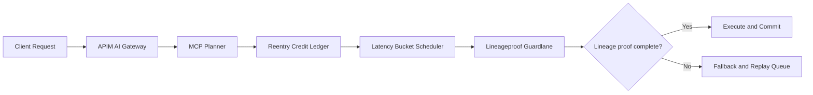

# Agent APIM/MCP 重入信用与延迟桶谱系证明护栏选型 FAQ（Cycle 2278）

## 1) 场景与约束
本轮聚焦 lineageproof guardlane（谱系证明护栏）：在 APIM AI Gateway、MCP 工具编排、重入信用账本与延迟桶调度链路中，要求系统在突发、重试与回放阶段保持可验证的谱系证明链。

## 2) Q1 / Q2 / Q3
Q1：谱系证明护栏与可追溯护栏差异？
A1：可追溯关注链路可回放，谱系证明进一步要求每一步证据可验证、防篡改且可审计复核。

Q2：为什么谱系证明必须覆盖重入信用账本？
A2：重入信用影响预算分配与重试优先级，缺少证明链会导致跨租户争议无法做法证级复核。

Q3：如何控制谱系证明校验热路径成本？
A3：热路径仅校验 proof_hash 与 lineage_anchor，冷路径离线执行全证据链签名验证。

## 3) 选型建议（Good fit / Not for）
Good fit：多租户 SaaS Agent Gateway、Browser/CUA 集群、高合规零信任执行环境。
Not for：一次性脚本任务、无需法证追溯的临时实验、无租户公平约束的单机流程。

## 4) 可复现实验范围
实验数据见 `evidence/cycle-2278-benchmark.json`，覆盖冷启动/热恢复 P50/P95、并发吞吐、策略拦截率、单会话成本，并标注 measured/synthetic/anonymized_reported。

## 5) 百分比契约绑定（N/D）
- `percentage_contract.unfenced_reentry_lineageproofguardlane_drift_rate`
- `percentage_contract.reentry_lineageproofguardlane_variance_rate`
- `percentage_contract.reentry_lineageproofguardlane_recovery_gain_pts`

以上键绑定本 FAQ 与 cycle-2278 证据，`production_validation=not_measured`。

## 6) 上线检查单
1. APIM 与 MCP 输出 lineage_anchor 与 fallback_reason。
2. 重入信用写入记录 proof_hash 与 trace_id。
3. 延迟桶调度结果附加谱系证明链哈希。
4. 预算耗尽请求进入降级与回放队列。
5. 回放工具支持按 trace_id 重建证明序列。
6. 日报保留 measured/synthetic/anonymized_reported 标签。
