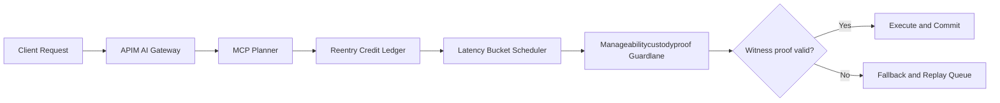

# Agent APIM/MCP Reentry Credit and Latency Bucket Witness-Custody-Proof Guardlane FAQ (Cycle 2353)

## 1) Context and constraints
This round focuses on the manageabilitycustodyproof guardlane. APIM AI Gateway, MCP orchestration, reentry-credit ledgers, and latency-bucket scheduling must preserve replayable witness evidence under retry bursts.

## 2) Q1 / Q2 / Q3
Q1: How is witness-custody closure different from ordinary audit logging?  
A1: Witness custody requires replay-verifiable decision proof for every reentry action, not just event records.

Q2: Why must witness proof be coupled with reentry credit?  
A2: Credit debit/recovery is the core gating action; without witness proof binding, fallback/allow decisions become unauditable.

Q3: How do we control proof overhead?  
A3: Hot path validates proof_hash and witness_token only, while cold path reconstructs full evidence chains.

## 3) Recommendation (Good fit / Not for)
Good fit: multi-tenant SaaS Agent Gateway, Browser/CUA clusters, and high-compliance zero-trust workloads.  
Not for: one-off offline scripts, tiny experiments without tenant isolation, or flows that do not require replay accountability.

## 4) Reproducible benchmark scope
Evidence is in `evidence/cycle-2353-benchmark.json`, covering cold/warm latency, throughput, policy interception, and per-session cost with measured/synthetic/anonymized_reported labels.

## 5) Percentage contract bindings (N/D)
- `percentage_contract.unfenced_reentry_manageabilitycustodyproofguardlane_drift_rate`
- `percentage_contract.reentry_manageabilitycustodyproofguardlane_variance_rate`
- `percentage_contract.reentry_manageabilitycustodyproofguardlane_recovery_gain_pts`

These keys bind this FAQ to cycle-2353 evidence, with `production_validation=not_measured`.

## 6) Production checklist
1. APIM and MCP emit proof_hash, witness_token, and fallback_reason.
2. Reentry-credit writes include trace_id and witness-chain digest.
3. Latency-bucket decisions persist allow/fallback rationale.
4. Budget-exhausted requests are routed to fallback and replay queues.
5. Replay tooling reconstructs witness-custody sequences by trace_id.
6. Reports preserve measured/synthetic/anonymized_reported labels.
