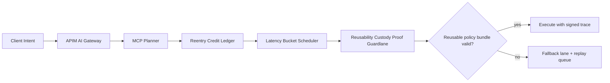

# Agent APIM/MCP Reentry Credit + Latency Bucket Reusability Custody Proof Guardlane FAQ (Cycle 2365)

## 1) Scenario and constraints
This round focuses on **modularitycustodyproof guardlane**. The objective is to make witness custody checks reusable across APIM AI Gateway, MCP orchestration, reentry-credit ledger, and latency-bucket scheduling so replay accountability remains deterministic under burst retries.

## 2) Q1 / Q2 / Q3
Q1: Why use reusable guardrails instead of one global switch?  
A1: Risk boundaries differ by tenant, model, and tool. Reusable checks isolate failures without collapsing the entire request path.  

Q2: How does reentry credit integrate with reusable proof custody?  
A2: Every retry writes credit_delta, proof_fragment_id, and trace_anchor; the replay pipeline reconstructs full custody proofs from these fragments.  

Q3: How do we avoid latency inflation from extra proof checks?  
A3: Hot path validates bundle digest/signature only; cold path rebuilds full proof asynchronously and routes failures into replay queues.

## 3) Selection guidance (Good fit / Not for)
Good fit: multi-tenant SaaS agent gateways, Browser/CUA pools, and high-compliance zero-trust finance lanes with replay accountability.  
Not for: one-off offline scripts, low-risk single-tenant jobs, and temporary flows with no replay/audit requirement.

## 4) Reproducible experiment scope
Evidence is in `evidence/cycle-2365-benchmark.json`, covering cold/warm P50/P95 latency, concurrency throughput, policy interception rate, and per-session cost, with measured/synthetic/anonymized_reported labels.

## 5) Percentage contract bindings (N/D)
- `percentage_contract.unfenced_reentry_modularitycustodyproofguardlane_drift_rate`
- `percentage_contract.reentry_modularitycustodyproofguardlane_variance_rate`
- `percentage_contract.reentry_modularitycustodyproofguardlane_recovery_gain_pts`

These keys bind this FAQ to cycle-2365 evidence, with `production_validation=not_measured`.

## 6) Production checklist
1. APIM policies emit bundle_id, proof_signature, and fallback_reason.  
2. MCP orchestration logs fragment order and policy-bundle version.  
3. Reentry-credit ledger records trace_anchor and delta origin.  
4. Latency-bucket fallback preserves replay_token and tenant-fairness labels.  
5. Replay tooling can reconstruct reusable custody chains by trace_id.  
6. Daily report and cards keep measured/synthetic/anonymized_reported labels aligned.  
