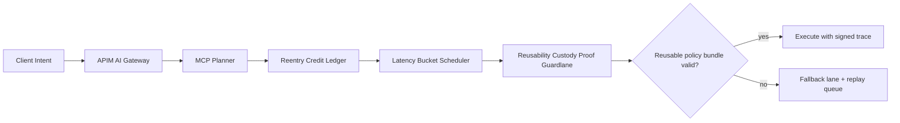

# Agent APIM/MCP 重入信用与延迟桶可组合托管证明护栏选型 FAQ（Cycle 2365）

## 1) 场景与约束
本轮聚焦 **modularitycustodyproof guardlane**：目标是在 APIM AI Gateway、MCP 工具编排、重入信用账本与延迟桶调度四层链路中，实现“可拆分、可拼接、可追溯”的见证托管策略，避免单点策略耦合导致回放歧义。

## 2) Q1 / Q2 / Q3
Q1：为什么要把护栏做成“可组合”而不是单一总开关？  
A1：因为多租户链路里每段风险不同。可组合护栏允许按租户、模型、工具、预算拆分校验，避免一个误判拖垮整条路径。  

Q2：重入信用与可组合见证如何联动？  
A2：每次重试都写入 credit_delta、proof_fragment_id、trace_anchor，聚合时再组合为完整见证链，确保扣减与恢复动作可审计。  

Q3：如何控制组合校验带来的时延放大？  
A3：热路径只校验 bundle 摘要和签名，冷路径异步重建全量证明；并把失败请求落入 replay 队列，防止前台阻塞。

## 3) 选型建议（Good fit / Not for）
Good fit：多租户 SaaS Agent Gateway、Browser/CUA 集群、需跨工具追责的金融零信任执行环境。  
Not for：单租户离线批处理、无回放审计要求的一次性脚本、短期 PoC 的低风险链路。

## 4) 可复现实验范围
实验数据位于 `evidence/cycle-2365-benchmark.json`，覆盖冷启动/热恢复 P50/P95、并发吞吐、策略拦截率、单会话成本；并显式标注 measured/synthetic/anonymized_reported。

## 5) 百分比契约绑定（N/D）
- `percentage_contract.unfenced_reentry_modularitycustodyproofguardlane_drift_rate`
- `percentage_contract.reentry_modularitycustodyproofguardlane_variance_rate`
- `percentage_contract.reentry_modularitycustodyproofguardlane_recovery_gain_pts`

以上键绑定当前 FAQ 与 cycle-2365 证据，且 `production_validation=not_measured`。

## 6) 上线检查单
1. APIM 策略输出 bundle_id、proof_signature、fallback_reason。  
2. MCP 编排日志记录 fragment 组合顺序与版本号。  
3. 重入信用账本写入 trace_anchor 与 delta 来源。  
4. 延迟桶降级时保留 replay_token 与租户公平性标签。  
5. 回放工具支持按 trace_id 还原组合见证链。  
6. 日报与卡组保持 measured/synthetic/anonymized_reported 标签一致。  
