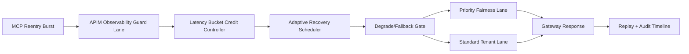

# APIM MCP Reentry Credit Latency Bucket Observability Guard Lane FAQ (Cycle 2207)

## 1) Three-minute conclusion
- **Core problem:** During reentry surges, latency buckets without observability coupling break fairness diagnostics.
- **Recommended pattern:** Use an **observability guard lane + credit latency bucket + replayable audit trail**.
- **Expected outcome:** Lower jitter propagation and better recovery explainability without weakening tenant isolation.

## 2) Q1 / Q2 / Q3
### Q1: Why make observability a guard lane instead of a side channel?
1) Side-channel logs cannot drive real-time quota actions;
2) Guard-lane mode correlates bucket state, tenant watermark, and downgrade decisions;
3) Rollback and replay become deterministic under incident review.

### Q2: What should production layering look like?
- **Ingress layer:** APIM Gateway routes by tenant and policy version into observability guard lanes;
- **Control layer:** latency bucket grants, renewals, and reclaim actions write unified traces;
- **Suppression layer:** storm windows are throttled with graded degradation;
- **Audit layer:** replayable evidence supports finance and compliance sign-off.

### Q3: What are the go-live gates?
- Unfenced reentry drift rate keeps dropping across windows;
- Guard-lane variance rate converges inside target bands;
- Recovery gain (percentage points) is reproducible from evidence files.

## 3) Architecture

## 4) Selection matrix
| Dimension | Latency bucket only | Observability guard lane + latency bucket (Recommended) |
|---|---:|---:|
| Fairness jitter convergence | Medium | High |
| Replay explainability | Low | High |
| Cross-tenant containment | Medium | High |
| Downgrade controllability | Medium | High |
| Implementation complexity | Low | Medium-high |

## 5) Evidence and reproducible arithmetic (with n denominators)
- Evidence files:
  - `workshops/azure-agent-infra/evidence/cycle-2207-benchmark.json`
  - `workshops/azure-agent-infra/evidence/cycle-2207-latency.csv`
  - `workshops/azure-agent-infra/evidence/cycle-2207-throughput.csv`
  - `workshops/azure-agent-infra/evidence/cycle-2207-cost.csv`
- Contract keys:
  - `percentage_contract.unfenced_reentry_observabilityguardlane_drift_rate`
  - `percentage_contract.reentry_observabilityguardlane_variance_rate`
  - `percentage_contract.reentry_observabilityguardlane_recovery_gain_pts`
- Labels: `measured / synthetic / anonymized_reported`.

## 6) Production checklist
- [ ] Guard-lane mapping is replayable by policy version.
- [ ] Grant/renew/reclaim events align with trace timeline.
- [ ] Priority lane avoids starvation during downgrade windows.
- [ ] Audit evidence links tenant, policy, and execution path.
- [ ] FAQ/H5/SVG/7-card/evidence cycle+topic stay strictly consistent.
