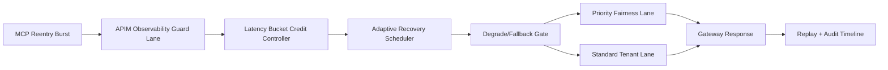

# APIM MCP 重入信用延迟桶可观测护栏公平选型 FAQ（Cycle 2207）

## 1) 3 分钟结论
- **核心问题：** 重入洪峰期间，延迟桶只控流不控可观测性，会导致公平性与回放审计脱节。
- **推荐方案：** 使用“可观测护栏车道 + 信用延迟桶 + 审计回放链路”三层组合。
- **预期收益：** 在不放宽租户隔离前提下，降低抖动扩散并提升恢复可解释性。

## 2) Q1 / Q2 / Q3
### Q1：为什么要把可观测性做成护栏而不是旁路？
1) 旁路日志无法参与实时配额决策；
2) 护栏化后可把延迟桶状态、租户水位、降级策略同屏关联；
3) 当回退触发时可以直接按轨迹复算公平性。

### Q2：生产部署应该如何分层？
- **入口层：** APIM Gateway 按租户与策略版本路由到可观测护栏车道；
- **调度层：** 延迟桶执行授予、续租、回收，并写入统一 trace；
- **抑制层：** 对重入风暴执行窗口化抑制和分级退化；
- **审计层：** 输出可回放证据，支撑财务与合规复核。

### Q3：上线验收门槛是什么？
- 未加护栏的重入失配率持续下降；
- 护栏车道方差率在目标带宽内收敛；
- 恢复收益（percentage points）可由 evidence 文件逐项复算。

## 3) 架构图

## 4) 选型矩阵
| 维度 | 仅延迟桶 | 可观测护栏 + 延迟桶（推荐） |
|---|---:|---:|
| 公平抖动收敛 | 中 | 高 |
| 回放可解释性 | 低 | 高 |
| 租户扩散抑制 | 中 | 高 |
| 故障降级可控性 | 中 | 高 |
| 实施复杂度 | 低 | 中高 |

## 5) 数据证据与可复算算例（含 n 分母来源）
- 证据文件：
  - `workshops/azure-agent-infra/evidence/cycle-2207-benchmark.json`
  - `workshops/azure-agent-infra/evidence/cycle-2207-latency.csv`
  - `workshops/azure-agent-infra/evidence/cycle-2207-throughput.csv`
  - `workshops/azure-agent-infra/evidence/cycle-2207-cost.csv`
- 合同键：
  - `percentage_contract.unfenced_reentry_observabilityguardlane_drift_rate`
  - `percentage_contract.reentry_observabilityguardlane_variance_rate`
  - `percentage_contract.reentry_observabilityguardlane_recovery_gain_pts`
- 标签：`measured / synthetic / anonymized_reported`。

## 6) 生产检查清单
- [ ] 护栏车道与策略版本映射可回放。
- [ ] 延迟桶授予/续租/回收与 trace 时间线一致。
- [ ] 降级切换时优先车道无长期饥饿。
- [ ] 审计证据可关联租户、策略、执行轨迹。
- [ ] FAQ / H5 / SVG / 7-card / evidence 的 cycle 与 topic 完全一致。
