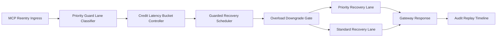

# APIM MCP Reentry Priority Guard Lane Latency Bucket FAQ (Cycle 2143)

## 1) Three-minute decision
- **Core issue:** peak reentry contention lets critical and standard tenants compete in the same latency bucket, which destabilizes recovery order.
- **Recommendation:** deploy a closed loop of priority guard lanes, latency-bucket allocation, overload downgrade gates, and replayable audit trails.
- **Goal:** preserve fairness while keeping high-priority recovery throughput deterministic.

## 2) Q1 / Q2 / Q3
### Q1: Why add a priority guard lane?
1) a single shared latency bucket amplifies cross-tenant jitter at burst boundaries,
2) guard lanes decouple critical and standard recovery paths,
3) with latency buckets, capacity, validity window, and order are jointly governed.

### Q2: What does the production layering look like?
- **Guard-lane layer:** classify tenant tier and map to lane-level recovery thresholds,
- **Allocation layer:** issue latency-bucket credit and renewal windows per lane,
- **Reclaim layer:** reclaim overdraft leases with anti-oscillation windows,
- **Downgrade layer:** trigger tiered downgrade + human review during saturation.

### Q3: What is the go-live bar?
- unfenced drift rate keeps declining,
- lane variance rate is bounded and replayable,
- recovery gain (percentage points) remains stable across windows.

## 3) Reference architecture

## 4) Decision matrix
| Dimension | Unified latency bucket | Priority Guard Lane + Latency Bucket (Recommended) |
|---|---:|---:|
| Critical-tenant recovery determinism | Medium | High |
| Cross-tenant jitter suppression | Medium | High |
| Replayable audit explainability | Medium | High |
| Peak downgrade stability | Medium | High |
| Implementation complexity | Medium | Medium-High |

## 5) Evidence and reproducibility
- Evidence files:
  - `workshops/azure-agent-infra/evidence/cycle-2143-benchmark.json`
  - `workshops/azure-agent-infra/evidence/cycle-2143-latency.csv`
  - `workshops/azure-agent-infra/evidence/cycle-2143-throughput.csv`
  - `workshops/azure-agent-infra/evidence/cycle-2143-cost.csv`
- Contract keys:
  - `percentage_contract.unfenced_reentry_priorityguardlane_drift_rate`
  - `percentage_contract.reentry_priorityguardlane_variance_rate`
  - `percentage_contract.reentry_priorityguardlane_recovery_gain_pts`
- Labels: `measured / synthetic / anonymized_reported`.

## 6) Production checklist
- [ ] Guard-lane classification is tenant-tier replayable.
- [ ] Bucket grant/renew/reclaim is lane-consistent.
- [ ] Critical lanes stay starvation-free during peak downgrade.
- [ ] Audit trails bind policy version, lane class, and recovery path.
- [ ] FAQ/H5/SVG/7-card/evidence stay cycle-topic consistent.
