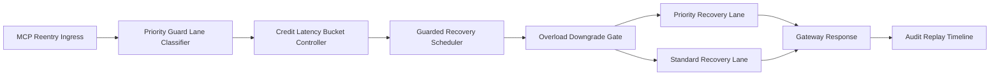

# APIM MCP 重入优先护栏延迟桶公平选型 FAQ（Cycle 2143）

## 1) 3 分钟结论
- **核心问题：** 重入高峰时关键租户与普通租户抢占同一延迟桶，导致恢复顺序漂移。
- **推荐方案：** “优先护栏车道 + 延迟桶配给 + 过载降档闸门 + 审计回放”闭环。
- **目标：** 在不牺牲公平性的前提下，保障高优先级恢复链路的确定性吞吐。

## 2) Q1 / Q2 / Q3
### Q1：为什么要引入 priority guard lane？
1) 仅用统一延迟桶会在突发边界时放大跨租户抖振；
2) 优先护栏把关键租户恢复路径与普通路径分离，避免互相放大；
3) 结合延迟桶可同时控制“额度、时效、恢复顺序”。

### Q2：生产分层应如何设计？
- **优先护栏层：** 先判定租户等级，映射到恢复车道与授信阈值；
- **配给层：** 按车道发放延迟桶额度与续租窗口；
- **回收层：** 对超额租约做窗口化回收，附带抖振抑制；
- **降档层：** 峰值拥塞时触发分级降档与人工复核门。

### Q3：上线判据是什么？
- 无护栏漂移率持续下降；
- 车道方差率可控并可解释；
- 恢复收益（percentage points）在多窗口内稳定复现。

## 3) 架构图

## 4) 选型矩阵
| 维度 | 统一延迟桶 | Priority Guard Lane + Latency Bucket（推荐） |
|---|---:|---:|
| 关键租户恢复确定性 | 中 | 高 |
| 跨租户抖振抑制 | 中 | 高 |
| 可解释审计回放 | 中 | 高 |
| 峰值降档稳定性 | 中 | 高 |
| 实施复杂度 | 中 | 中高 |

## 5) 数据证据与可复算算例（含 n 分母来源）
- 证据文件：
  - `workshops/azure-agent-infra/evidence/cycle-2143-benchmark.json`
  - `workshops/azure-agent-infra/evidence/cycle-2143-latency.csv`
  - `workshops/azure-agent-infra/evidence/cycle-2143-throughput.csv`
  - `workshops/azure-agent-infra/evidence/cycle-2143-cost.csv`
- 合同键：
  - `percentage_contract.unfenced_reentry_priorityguardlane_drift_rate`
  - `percentage_contract.reentry_priorityguardlane_variance_rate`
  - `percentage_contract.reentry_priorityguardlane_recovery_gain_pts`
- 标签：`measured / synthetic / anonymized_reported`。

## 6) 生产检查清单
- [ ] 优先护栏映射规则可按租户等级重放。
- [ ] 延迟桶授予/续租/回收与护栏车道映射一致。
- [ ] 峰值降档时关键车道无饥饿。
- [ ] 审计链路可关联策略版本、护栏等级与恢复轨迹。
- [ ] FAQ/H5/SVG/7-card/evidence 的 cycle/topic 一致。
