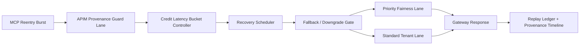

# APIM MCP 重入信用延迟桶溯源护栏公平选型 FAQ（Cycle 2227）

## 1) 3 分钟结论
- **核心问题：** 重入治理缺少溯源护栏时，公平动作可能正确执行却难以证明跨窗口口径一致。
- **推荐方案：** 采用“溯源护栏车道 + 延迟桶信用控制 + 回放溯源账本”闭环。
- **预期收益：** 在多租户高并发下同时提升恢复稳定性、口径溯源与审计溯源。

## 2) Q1 / Q2 / Q3
### Q1：为什么 provenance guard lane 必须在线？
1) 离线日志无法实时约束额度回收与回退动作；
2) 车道级溯源标识可绑定策略版本、租户水位与降级路径；
3) 复盘可按溯源链逐段复算，避免跨班次口径漂移。

### Q2：生产分层怎么落地？
- **入口层：** APIM Gateway 按租户等级与策略版本进入溯源护栏车道；
- **控制层：** 延迟桶执行授予/续租/回收并写入 provenance id；
- **抑制层：** 风暴窗口执行分级降档与扩散阻断；
- **核验层：** 回放账本按 provenance id 还原路径并核对公平指标。

### Q3：上线门槛是什么？
- 未加护栏失配率持续下降；
- 护栏方差率收敛到目标区间；
- 恢复收益（percentage points）可由 evidence 文件复算。

## 3) 架构图

## 4) 选型矩阵
| 维度 | 仅延迟桶 | Provenance Guard Lane + Latency Bucket（推荐） |
|---|---:|---:|
| 公平抖动收敛 | 中 | 高 |
| 决策口径溯源 | 低 | 高 |
| 租户扩散抑制 | 中 | 高 |
| 回退可解释性 | 中 | 高 |
| 实施复杂度 | 低 | 中高 |

## 5) 数据证据与可复算算例（含 n 分母来源）
- 证据文件：
  - `workshops/azure-agent-infra/evidence/cycle-2227-benchmark.json`
  - `workshops/azure-agent-infra/evidence/cycle-2227-latency.csv`
  - `workshops/azure-agent-infra/evidence/cycle-2227-throughput.csv`
  - `workshops/azure-agent-infra/evidence/cycle-2227-cost.csv`
- 合同键：
  - `percentage_contract.unfenced_reentry_provenanceguardlane_drift_rate`
  - `percentage_contract.reentry_provenanceguardlane_variance_rate`
  - `percentage_contract.reentry_provenanceguardlane_recovery_gain_pts`
- 标签：`measured / synthetic / anonymized_reported`。

## 6) 生产检查清单
- [ ] 车道分配与策略版本溯源可回放。
- [ ] 授予/续租/回收事件与 provenance id 对齐。
- [ ] 降级窗口内优先车道无饥饿。
- [ ] 账本可关联租户、策略与执行路径。
- [ ] FAQ / H5 / SVG / 7-card / evidence 的 cycle 与 topic 严格一致。
