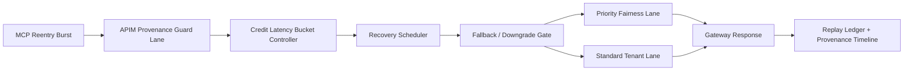

# APIM MCP Reentry Credit Latency Bucket Provenance Guard Lane FAQ (Cycle 2237)

## 1) Three-minute conclusion
- **Core problem:** Without provenance guard lanes, fairness actions may execute correctly but cross-window decision provenance is unprovable.
- **Recommended pattern:** Use a **provenance guard lane + credit latency bucket + replay provenance ledger**.
- **Expected outcome:** Better recovery stability, provenance, and audit provenance under multi-tenant load.

## 2) Q1 / Q2 / Q3
### Q1: Why must provenance guard lanes be inline?
1) Offline logs cannot constrain real-time reclaim and fallback actions;
2) Lane-level provenance IDs bind policy version, tenant watermark, and downgrade path;
3) Replay can be recomputed segment-by-segment without cross-shift drift.

### Q2: How should production layering be implemented?
- **Ingress:** APIM Gateway maps tenant tier + policy version into provenance lanes;
- **Control:** latency bucket grant/renew/reclaim writes provenance IDs;
- **Suppression:** burst windows apply graded degradation and spread containment;
- **Verification:** replay ledger reconstructs path by provenance ID and validates fairness metrics.

### Q3: What are go-live gates?
- Unfenced drift rate trends downward;
- Guard-lane variance converges inside target bands;
- Recovery gain (percentage points) is reproducible from evidence.

## 3) Architecture

## 4) Selection matrix
| Dimension | Latency bucket only | Provenance guard lane + latency bucket (Recommended) |
|---|---:|---:|
| Fairness jitter convergence | Medium | High |
| Decision provenance | Low | High |
| Cross-tenant containment | Medium | High |
| Fallback explainability | Medium | High |
| Implementation complexity | Low | Medium-high |

## 5) Evidence and reproducible arithmetic (with n denominators)
- Evidence files:
  - `workshops/azure-agent-infra/evidence/cycle-2237-benchmark.json`
  - `workshops/azure-agent-infra/evidence/cycle-2237-latency.csv`
  - `workshops/azure-agent-infra/evidence/cycle-2237-throughput.csv`
  - `workshops/azure-agent-infra/evidence/cycle-2237-cost.csv`
- Contract keys:
  - `percentage_contract.unfenced_reentry_provenanceguardlane_drift_rate`
  - `percentage_contract.reentry_provenanceguardlane_variance_rate`
  - `percentage_contract.reentry_provenanceguardlane_recovery_gain_pts`
- Labels: `measured / synthetic / anonymized_reported`.

## 6) Production checklist
- [ ] Lane assignment and policy provenance are replayable.
- [ ] Grant/renew/reclaim events align with provenance IDs.
- [ ] Priority lane avoids starvation during downgrade windows.
- [ ] Ledger links tenant, policy, and execution path.
- [ ] FAQ/H5/SVG/7-card/evidence cycle+topic stay consistent.
