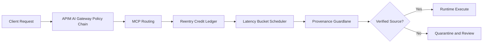

# Agent APIM/MCP Reentry Credit and Latency Bucket Provenance Guardlane FAQ (Cycle 2252)

## 1) Context and constraints
This cycle focuses on provenance guardlane design: every reentry-credit decision in APIM AI Gateway and MCP orchestration must map to verifiable source evidence. Priority order is provenance integrity first, tenant isolation second, latency optimization third.

## 2) Q1 / Q2 / Q3
Q1: How is provenance guardrail different from lineage guardrail?
A1: Lineage validates continuity of history, while provenance validates trustworthiness of source evidence for each critical decision.

Q2: Why enforce provenance before execution?
A2: Post-execution evidence repair cannot undo side effects in multi-tenant write paths.

Q3: Will provenance checks hurt throughput?
A3: Split checks into hot-path hash/signature verification and cold-path asynchronous deep review.

## 3) Recommendation (Good fit / Not for)
Good fit: regulated SaaS Agent Gateway, cross-team operations, replayable and explainable decision traces.
Not for: single-host experiments, one-off scripts, short flows without audit retention.

## 4) Reproducible benchmark scope
Baseline evidence is in `evidence/cycle-2252-benchmark.json`, including cold/warm latency, throughput, policy interception, and session cost with explicit measured/synthetic/anonymized_reported tags.

## 5) Percentage contract bindings (N/D)
- `percentage_contract.unfenced_reentry_provenanceguardlane_drift_rate`
- `percentage_contract.reentry_provenanceguardlane_variance_rate`
- `percentage_contract.reentry_provenanceguardlane_recovery_gain_pts`

These keys bind to this FAQ and cycle-2252 evidence with `production_validation=not_measured`.

## 6) Production checklist
1. APIM policies must emit source_ref and source_label.
2. MCP routing logs retain request hash and policy hash.
3. Reentry-credit ledger entries include provenance token.
4. Failed provenance checks are quarantined, never silently bypassed.
5. Replay tooling reconstructs critical paths from trace_id.
6. Cycle reports preserve measured/synthetic/anonymized_reported distinctions.
