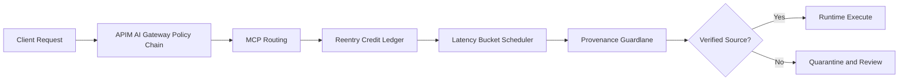

# Agent APIM/MCP 重入信用与延迟桶来源护栏选型 FAQ（Cycle 2252）

## 1) 场景与约束
本轮关注 provenance guardlane（来源护栏）：在 APIM AI Gateway + MCP 生产编排中，保证每一次重入信用扣减都可追溯到来源证据，防止“账本正确但来源不明”的伪一致状态。约束优先级：来源可验 > 租户隔离 > 延迟最优。

## 2) Q1 / Q2 / Q3
Q1：来源护栏与系谱护栏差异是什么？
A1：系谱强调“链路历史是否连续”，来源强调“每个关键决策是否能映射到可信证据”。系谱可连续但来源仍可能失真。

Q2：为什么来源校验要在执行前完成？
A2：执行后再补证据会出现不可逆副作用，尤其在多租户写路径上会放大风险。

Q3：来源校验会不会拖垮吞吐？
A3：把来源校验拆为热路径（哈希和签名）与冷路径（全文复核），热路径命中后放行，冷路径异步复核。

## 3) 选型建议（Good fit / Not for）
Good fit：跨团队协作、需监管留痕、要求“可解释且可重放”的 SaaS Agent Gateway。
Not for：离线单机试玩、一次性脚本任务、不保留审计证据的短链路流程。

## 4) 可复现实验范围
基线数据在 `evidence/cycle-2252-benchmark.json`：冷启动/热恢复、并发吞吐、策略拦截率、会话成本均带来源标签（measured/synthetic/anonymized_reported）。

## 5) 百分比契约绑定（N/D）
- `percentage_contract.unfenced_reentry_provenanceguardlane_drift_rate`
- `percentage_contract.reentry_provenanceguardlane_variance_rate`
- `percentage_contract.reentry_provenanceguardlane_recovery_gain_pts`

以上键绑定本 FAQ 与 cycle-2252 证据；`production_validation=not_measured`。

## 6) 上线检查单
1. APIM 策略必须输出 source_ref 和 source_label。
2. MCP 路由日志需保留 request hash 与 policy hash。
3. 重入信用扣减必须附带 provenance token。
4. 来源校验失败流量进入隔离队列，不允许静默放行。
5. 回放工具可用 trace_id 重建关键决策路径。
6. 周期复盘报告必须区分 measured/synthetic/anonymized_reported。
