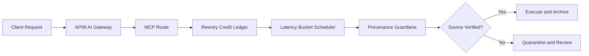

# Agent APIM/MCP Reentry Credit and Latency Bucket Provenance Guardlane FAQ (Cycle 2257)

## 1) Context and constraints
This cycle focuses on provenance guardlane design. APIM AI Gateway, MCP routing, reentry-credit ledgers, and latency-bucket decisions must map to verifiable evidence sources.

## 2) Q1 / Q2 / Q3
Q1: How does provenance differ from lineage?
A1: Lineage ensures continuity across stages; provenance ensures each decision is backed by trusted evidence.

Q2: Why enforce provenance before execution?
A2: Post-execution evidence patching cannot safely undo multi-tenant side effects.

Q3: How do we control provenance-check overhead?
A3: Use hash and signature summaries on hot path and sampled deep review on cold path.

## 3) Recommendation (Good fit / Not for)
Good fit: regulated multi-tenant SaaS Agent Gateway with accountability and explainability needs.
Not for: short offline scripts without audit retention requirements.

## 4) Reproducible benchmark scope
Evidence is in `evidence/cycle-2257-benchmark.json`, including cold/warm latency, throughput, policy interception, and per-session cost with N/D-based percentages.

## 5) Percentage contract bindings (N/D)
- `percentage_contract.unfenced_reentry_provenanceguardlane_drift_rate`
- `percentage_contract.reentry_provenanceguardlane_variance_rate`
- `percentage_contract.reentry_provenanceguardlane_recovery_gain_pts`

These keys bind to this FAQ and cycle-2257 evidence with `production_validation=not_measured`.

## 6) Production checklist
1. APIM and MCP emit source_ref and source_label.
2. Reentry-credit writes include provenance token and policy_hash.
3. Latency-bucket decisions keep source version and trace_id.
4. Failed provenance checks route to quarantine queue.
5. Replay tooling reconstructs provenance evidence chain.
6. Reports preserve measured/synthetic/anonymized_reported labels.
