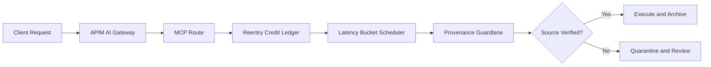

# Agent APIM/MCP 重入信用与延迟桶来源护栏选型 FAQ（Cycle 2267）

## 1) 场景与约束
本轮聚焦 provenance guardlane（来源护栏）：要求 APIM AI Gateway、MCP 路由、重入信用账本与延迟桶决策都能映射到可验证来源，避免“决策可执行但来源不可证”。核心优先级：来源可证 > 租户隔离 > 吞吐优化。

## 2) Q1 / Q2 / Q3
Q1：来源护栏和系谱护栏如何分工？
A1：系谱护栏保证链路连续性，来源护栏保证每个关键判断都可回溯到可信证据。

Q2：为何来源校验必须前置？
A2：执行后再补来源会造成不可逆副作用，尤其在多租户写路径中风险更高。

Q3：来源校验如何控制成本？
A3：热路径做哈希与签名摘要核验，冷路径做抽样深度复核。

## 3) 选型建议（Good fit / Not for）
Good fit：受监管的多租户 SaaS Agent Gateway、强调可追责与可解释决策链的场景。
Not for：离线短脚本、无审计留痕要求的单次任务。

## 4) 可复现实验范围
实验基线见 `evidence/cycle-2267-benchmark.json`，覆盖冷启动/热恢复、吞吐、策略拦截率、单会话成本；百分比按 N/D 复算并携带来源标签。

## 5) 百分比契约绑定（N/D）
- `percentage_contract.unfenced_reentry_provenanceguardlane_drift_rate`
- `percentage_contract.reentry_provenanceguardlane_variance_rate`
- `percentage_contract.reentry_provenanceguardlane_recovery_gain_pts`

以上键绑定本 FAQ 与 cycle-2267 证据，`production_validation=not_measured`。

## 6) 上线检查单
1. APIM 与 MCP 输出 source_ref 与 source_label。
2. 重入信用写入带 provenance token 与 policy_hash。
3. 延迟桶决策记录来源版本号与 trace_id。
4. 来源校验失败流量进入隔离队列。
5. 回放工具可还原来源证据链。
6. 报告保留 measured/synthetic/anonymized_reported 标签。
