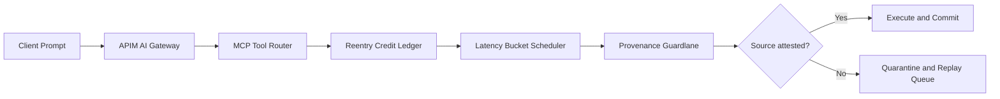

# Agent APIM/MCP Reentry Credit and Latency Bucket Provenance Guardlane FAQ (Cycle 2272)

## 1) Context and constraints
This cycle targets provenance guardlane design. APIM AI Gateway, MCP orchestration, reentry-credit ledgers, and latency-bucket scheduling must attach verifiable source evidence to each decision hop.

## 2) Q1 / Q2 / Q3
Q1: How is provenance different from lineage?
A1: Lineage validates continuity across hops; provenance validates trustworthiness and auditability of the evidence itself.

Q2: Why enforce provenance checks before execution?
A2: Post-execution tagging cannot repair tainted critical paths or recover lost source context.

Q3: How do we limit provenance-check overhead?
A3: Hot path checks source_id, fetched_at, and label; cold path performs sampled deep source reconciliation.

## 3) Recommendation (Good fit / Not for)
Good fit: multi-tenant SaaS Agent Gateway, financial audit environments, and cross-region replay governance.
Not for: temporary offline scripts, single-tenant experiments, and prototypes without compliance accountability.

## 4) Reproducible benchmark scope
Evidence is in `evidence/cycle-2272-benchmark.json`, including cold/warm latency, throughput, policy interception, and per-session cost with measured/synthetic/anonymized_reported labels.

## 5) Percentage contract bindings (N/D)
- `percentage_contract.unfenced_reentry_provenanceguardlane_drift_rate`
- `percentage_contract.reentry_provenanceguardlane_variance_rate`
- `percentage_contract.reentry_provenanceguardlane_recovery_gain_pts`

These keys bind this FAQ to cycle-2272 evidence with `production_validation=not_measured`.

## 6) Production checklist
1. APIM and MCP emit source_id and source_label.
2. Reentry-credit writes include source_epoch and trace_id.
3. Latency-bucket decisions carry source snapshot hash.
4. Missing-source requests route to quarantine and replay queue.
5. Replay tooling reconstructs source mappings by trace_id.
6. Reports preserve measured/synthetic/anonymized_reported labels.
