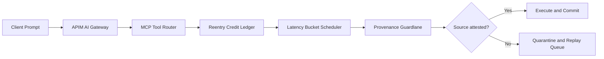

# Agent APIM/MCP 重入信用与延迟桶来源护栏选型 FAQ（Cycle 2272）

## 1) 场景与约束
本轮聚焦 provenance guardlane（来源护栏）：在 APIM AI Gateway、MCP 工具编排、重入信用账本、延迟桶调度的联动路径中，要求每次决策都可绑定来源证据与时间戳，防止“结果可用但来源不可证”的灰区。

## 2) Q1 / Q2 / Q3
Q1：来源护栏与系谱护栏差异？
A1：系谱护栏关注链路连续性，来源护栏关注每一跳证据本身是否可信、可验证、可复查。

Q2：为什么来源校验必须前置到策略阶段？
A2：若执行后才补来源标记，关键路径已被污染，事后追溯无法恢复原始上下文。

Q3：如何控制来源校验开销？
A3：热路径仅验 source_id、fetched_at、label；冷路径按策略抽样做深度来源对账。

## 3) 选型建议（Good fit / Not for）
Good fit：多租户 SaaS Agent Gateway、金融审计环境、跨区域重放治理。
Not for：临时离线脚本、单租户试验、无合规追责要求的原型验证。

## 4) 可复现实验范围
实验数据见 `evidence/cycle-2272-benchmark.json`，覆盖冷启动/热恢复 P50/P95、并发吞吐、策略拦截率、单会话成本，全部携带 measured/synthetic/anonymized_reported 标签。

## 5) 百分比契约绑定（N/D）
- `percentage_contract.unfenced_reentry_provenanceguardlane_drift_rate`
- `percentage_contract.reentry_provenanceguardlane_variance_rate`
- `percentage_contract.reentry_provenanceguardlane_recovery_gain_pts`

以上键绑定本 FAQ 与 cycle-2272 证据，`production_validation=not_measured`。

## 6) 上线检查单
1. APIM 与 MCP 输出 source_id 与 source_label。
2. 重入信用写入记录 source_epoch 与 trace_id。
3. 延迟桶调度结果附加 source snapshot hash。
4. 任一来源缺失请求进入隔离与回放队列。
5. 回放工具支持按 trace_id 回溯来源映射。
6. 日报保留 measured/synthetic/anonymized_reported 标签。
