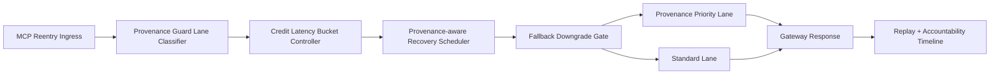

# APIM MCP Reentry Provenance Guard Lane Latency Bucket FAQ (Cycle 2168)

## 1) Three-minute decision
- **Core issue:** under reentry peaks, policy provenance tracking becomes unstable, causing fairness allocation and replay audits to drift.
- **Recommendation:** enforce a closed loop of provenance guard lanes, latency-bucket allocation, fallback downgrade gates, and replay accountability.
- **Goal:** preserve multi-tenant fairness while narrowing provenance-drift windows and rollback propagation cost.

## 2) Q1 / Q2 / Q3
### Q1: Why add a provenance guard lane?
1) unified throttling cannot distinguish provenance trust classes,
2) provenance lanes isolate high-risk reentry streams during policy switches,
3) with latency buckets, credit, ordering, and provenance integrity are bounded jointly.

### Q2: How should production layering work?
- **Provenance guard layer:** map tenant tier + signature state into recovery lanes,
- **Allocation layer:** manage lane-scoped bucket credit, renewal, and reclaim windows,
- **Reclaim layer:** reclaim overdraft leases while suppressing propagation,
- **Downgrade layer:** trigger fallback downgrade at peak with replayable evidence.

### Q3: What is the go-live bar?
- unfenced provenance drift keeps shrinking,
- lane variance is stable and explainable,
- recovery gain (percentage points) remains reproducible across windows.

## 3) Reference architecture

## 4) Decision matrix
| Dimension | Unified latency bucket | Provenance Guard Lane + Latency Bucket (Recommended) |
|---|---:|---:|
| Provenance drift control | Medium | High |
| Cross-tenant propagation suppression | Medium | High |
| Replay accountability | Medium | High |
| Peak downgrade stability | Medium | High |
| Implementation complexity | Medium | Medium-High |

## 5) Evidence and reproducibility
- Evidence files:
  - `workshops/azure-agent-infra/evidence/cycle-2168-benchmark.json`
  - `workshops/azure-agent-infra/evidence/cycle-2168-latency.csv`
  - `workshops/azure-agent-infra/evidence/cycle-2168-throughput.csv`
  - `workshops/azure-agent-infra/evidence/cycle-2168-cost.csv`
- Contract keys:
  - `percentage_contract.unfenced_reentry_provenanceguardlane_drift_rate`
  - `percentage_contract.reentry_provenanceguardlane_variance_rate`
  - `percentage_contract.reentry_provenanceguardlane_recovery_gain_pts`
- Labels: `measured / synthetic / anonymized_reported`.

## 6) Production checklist
- [ ] Provenance-lane mapping is tenant-tier replayable.
- [ ] Bucket grant/renew/reclaim is provenance-lane consistent.
- [ ] Provenance-priority lanes stay starvation-free during peak downgrade.
- [ ] Audit trails bind policy version, source signature, and recovery path.
- [ ] FAQ/H5/SVG/7-card/evidence stay cycle-topic consistent.
