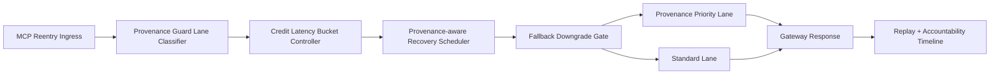

# APIM MCP 重入来源护栏延迟桶公平选型 FAQ（Cycle 2168）

## 1) 3 分钟结论
- **核心问题：** 重入高峰下策略来源链追踪不稳定，导致公平配给与回放审计发生偏移。
- **推荐方案：** “来源护栏车道 + 延迟桶配给 + 回退旁路 + 回放追责”闭环治理。
- **目标：** 在多租户公平前提下，收敛来源漂移窗口并降低回退扩散成本。

## 2) Q1 / Q2 / Q3
### Q1：为什么需要 provenance guard lane？
1) 统一限流无法区分来源可信度；
2) 来源护栏可在策略切换期隔离高风险重入流；
3) 与延迟桶协同后可联合约束额度、时序与来源完整性。

### Q2：生产分层如何落地？
- **来源护栏层：** 按租户等级与来源签名映射恢复车道；
- **配给层：** 车道内管理延迟桶额度、续租与回收窗口；
- **回收层：** 对超额租约执行窗口化回收与扩散抑制；
- **降档层：** 峰值触发旁路降档并保留可回放证据。

### Q3：上线判据是什么？
- 无护栏来源漂移率持续收敛；
- 来源护栏车道方差率可解释且稳定；
- 恢复收益（percentage points）跨窗口可复算。

## 3) 架构图

## 4) 选型矩阵
| 维度 | 统一延迟桶 | Provenance Guard Lane + Latency Bucket（推荐） |
|---|---:|---:|
| 来源漂移控制 | 中 | 高 |
| 跨租户扩散抑制 | 中 | 高 |
| 回放可追责性 | 中 | 高 |
| 峰值降档稳定性 | 中 | 高 |
| 实施复杂度 | 中 | 中高 |

## 5) 数据证据与可复算算例（含 n 分母来源）
- 证据文件：
  - `workshops/azure-agent-infra/evidence/cycle-2168-benchmark.json`
  - `workshops/azure-agent-infra/evidence/cycle-2168-latency.csv`
  - `workshops/azure-agent-infra/evidence/cycle-2168-throughput.csv`
  - `workshops/azure-agent-infra/evidence/cycle-2168-cost.csv`
- 合同键：
  - `percentage_contract.unfenced_reentry_provenanceguardlane_drift_rate`
  - `percentage_contract.reentry_provenanceguardlane_variance_rate`
  - `percentage_contract.reentry_provenanceguardlane_recovery_gain_pts`
- 标签：`measured / synthetic / anonymized_reported`。

## 6) 生产检查清单
- [ ] provenance 护栏映射可按租户等级重放。
- [ ] 延迟桶授予/续租/回收与来源护栏一致。
- [ ] 峰值降档时来源优先车道无饥饿。
- [ ] 审计链路可关联策略版本、来源签名与恢复轨迹。
- [ ] FAQ/H5/SVG/7-card/evidence 的 cycle/topic 一致。
