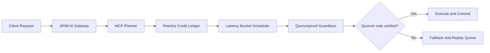

# Agent APIM/MCP Reentry Credit and Latency Bucket Quorum-Proof Guardlane FAQ (Cycle 2281)

## 1) Context and constraints
This cycle focuses on quorumproof guardlane design. APIM AI Gateway, MCP orchestration, reentry-credit ledgers, and latency-bucket scheduling must preserve verifiable quorum decisions under burst and retry pressure.

## 2) Q1 / Q2 / Q3
Q1: How is quorum-proof different from consensus guardlane?
A1: Consensus focuses on stable outcomes; quorum-proof adds verifiable arbitration evidence for multi-path voting.

Q2: Why must quorum-proof checks include reentry-credit ledgers?
A2: Reentry credit controls budget and priority, so missing quorum checks blocks objective tenant arbitration.

Q3: How can quorum-proof checks remain efficient?
A3: Hot path checks quorum_hash and vote_weight, while cold path replays full arbitration trajectories offline.

## 3) Recommendation (Good fit / Not for)
Good fit: multi-tenant SaaS Agent Gateway, Browser/CUA clusters, and high-compliance zero-trust execution.
Not for: one-off scripts, temporary experiments without multi-path arbitration needs, and single-node flows without tenant fairness constraints.

## 4) Reproducible benchmark scope
Evidence is in `evidence/cycle-2281-benchmark.json`, including cold/warm latency, throughput, policy interception, and per-session cost with measured/synthetic/anonymized_reported labels.

## 5) Percentage contract bindings (N/D)
- `percentage_contract.unfenced_reentry_quorumproofguardlane_drift_rate`
- `percentage_contract.reentry_quorumproofguardlane_variance_rate`
- `percentage_contract.reentry_quorumproofguardlane_recovery_gain_pts`

These keys bind this FAQ to cycle-2281 evidence with `production_validation=not_measured`.

## 6) Production checklist
1. APIM and MCP emit quorum_hash and fallback_reason.
2. Reentry-credit writes include vote_weight and trace_id.
3. Latency-bucket decisions carry arbitration-vote hash.
4. Budget-exhausted requests route to fallback and replay queues.
5. Replay tooling reconstructs arbitration sequences by trace_id.
6. Reports preserve measured/synthetic/anonymized_reported labels.
