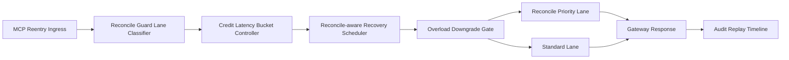

# APIM MCP Reentry Reconcile Guard Lane Latency Bucket FAQ (Cycle 2150)

## 1) Three-minute decision
- **Core issue:** under reentry peaks with tenant ledger drift, latency-bucket recovery ordering diverges during reconciliation.
- **Recommendation:** deploy a closed loop of reconcile guard lanes, latency-bucket allocation, tiered downgrade gates, and replay audit.
- **Goal:** preserve tenant fairness while bounding jitter and rollback blast radius during reconciliation windows.

## 2) Q1 / Q2 / Q3
### Q1: Why add a reconcile guard lane?
1) unified throttling cannot constrain ledger-drift skew,
2) reconcile lanes isolate high-risk sessions and verify quota state first,
3) with latency buckets, capacity, validity, ordering, and reconciliation boundaries are jointly governed.

### Q2: How should production layering work?
- **Reconcile guard layer:** map tenant class + ledger consistency into recovery lanes,
- **Allocation layer:** issue lane-scoped bucket credit and renewal windows,
- **Reclaim layer:** reclaim overdraft leases with anti-oscillation windows,
- **Downgrade layer:** trigger tiered downgrade and human replay queue during peaks.

### Q3: What is the go-live bar?
- unfenced drift rate keeps declining,
- reconcile-lane variance remains stable and traceable,
- recovery gain (percentage points) stays reproducible across windows.

## 3) Reference architecture

## 4) Decision matrix
| Dimension | Unified latency bucket | Reconcile Guard Lane + Latency Bucket (Recommended) |
|---|---:|---:|
| Reconciliation drift control | Medium | High |
| Cross-tenant jitter suppression | Medium | High |
| Reconciliation replay explainability | Medium | High |
| Peak downgrade stability | Medium | High |
| Implementation complexity | Medium | Medium-High |

## 5) Evidence and reproducibility
- Evidence files:
  - `workshops/azure-agent-infra/evidence/cycle-2150-benchmark.json`
  - `workshops/azure-agent-infra/evidence/cycle-2150-latency.csv`
  - `workshops/azure-agent-infra/evidence/cycle-2150-throughput.csv`
  - `workshops/azure-agent-infra/evidence/cycle-2150-cost.csv`
- Contract keys:
  - `percentage_contract.unfenced_reentry_reconcileguardlane_drift_rate`
  - `percentage_contract.reentry_reconcileguardlane_variance_rate`
  - `percentage_contract.reentry_reconcileguardlane_recovery_gain_pts`
- Labels: `measured / synthetic / anonymized_reported`.

## 6) Production checklist
- [ ] Reconcile-lane classification is tenant-class replayable.
- [ ] Bucket grant/renew/reclaim is reconcile-lane consistent.
- [ ] Reconcile-priority lanes stay starvation-free during peak downgrade.
- [ ] Audit trails bind policy version, reconcile class, and recovery path.
- [ ] FAQ/H5/SVG/7-card/evidence stay cycle-topic consistent.
