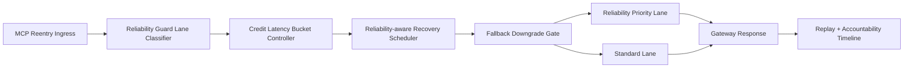

# APIM MCP Reentry Reliability Guard Lane Latency Bucket FAQ (Cycle 2174)

## 1) Three-minute decision
- **Core issue:** during reentry peaks, execution reliability drift amplifies fairness deviation and rollback spread.
- **Recommendation:** run a closed loop of reliability guard lanes, latency-bucket allocation, fallback downgrade gates, and replay accountability.
- **Goal:** under multi-tenant fairness constraints, shrink reliability-drift windows and rollback amplification cost.

## 2) Q1 / Q2 / Q3
### Q1: Why add a reliability guard lane?
1) unified throttling cannot separate reliability risk classes,
2) reliability lanes isolate high-risk reentry flows during policy transitions,
3) with latency buckets, credit, ordering, and reliability boundaries are jointly bounded.

### Q2: How should production layering work?
- **Reliability guard layer:** map tenant tier + reliability signature into recovery lanes,
- **Allocation layer:** manage lane-scoped bucket credit, renewal, and reclaim windows,
- **Reclaim layer:** reclaim overdraft leases while suppressing spread,
- **Downgrade layer:** trigger fallback downgrade at peak with accountable replay evidence.

### Q3: What is the go-live bar?
- unfenced reliability drift keeps shrinking,
- lane variance remains stable and explainable,
- recovery gain (percentage points) is reproducible across windows.

## 3) Reference architecture

## 4) Decision matrix
| Dimension | Unified latency bucket | Reliability Guard Lane + Latency Bucket (Recommended) |
|---|---:|---:|
| Reliability drift control | Medium | High |
| Cross-tenant propagation suppression | Medium | High |
| Replay accountability | Medium | High |
| Peak downgrade stability | Medium | High |
| Implementation complexity | Medium | Medium-High |

## 5) Evidence and reproducibility
- Evidence files:
  - `workshops/azure-agent-infra/evidence/cycle-2174-benchmark.json`
  - `workshops/azure-agent-infra/evidence/cycle-2174-latency.csv`
  - `workshops/azure-agent-infra/evidence/cycle-2174-throughput.csv`
  - `workshops/azure-agent-infra/evidence/cycle-2174-cost.csv`
- Contract keys:
  - `percentage_contract.unfenced_reentry_reliabilityguardlane_drift_rate`
  - `percentage_contract.reentry_reliabilityguardlane_variance_rate`
  - `percentage_contract.reentry_reliabilityguardlane_recovery_gain_pts`
- Labels: `measured / synthetic / anonymized_reported`.

## 6) Production checklist
- [ ] Reliability-lane mapping is tenant-tier replayable.
- [ ] Bucket grant/renew/reclaim is reliability-lane consistent.
- [ ] Reliability-priority lanes stay starvation-free during peak downgrade.
- [ ] Audit trails bind policy version, reliability signature, and recovery path.
- [ ] FAQ/H5/SVG/7-card/evidence stay cycle-topic consistent.
