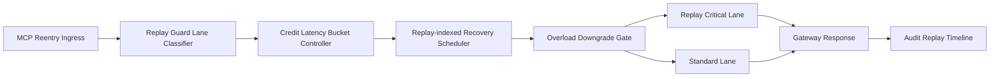

# APIM MCP Reentry Replay Guard Lane Latency Bucket FAQ (Cycle 2145)

## 1) Three-minute decision
- **Core issue:** after burst reentry, missing replay guardrails leaves latency-bucket disputes hard to reconstruct.
- **Recommendation:** deploy a closed loop of replay guard lanes, latency-bucket allocation, peak downgrade gates, and indexed audit replay.
- **Goal:** preserve tenant fairness with reproducible and accountable recovery paths.

## 2) Q1 / Q2 / Q3
### Q1: Why add a replay guard lane?
1) real-time blocking alone cannot explain historical contention,
2) replay lanes separate critical and standard recovery and retain trajectory evidence,
3) combined with latency buckets, capacity, validity, order, and traceability are jointly controlled.

### Q2: How should production layering work?
- **Replay guard layer:** classify tenant/session class and bind replay indexes,
- **Allocation layer:** issue lane-scoped bucket credit and renewal windows,
- **Reclaim layer:** reclaim overdraft leases with anti-oscillation windows,
- **Downgrade layer:** trigger tiered downgrade and human replay review at saturation.

### Q3: What is the go-live bar?
- unfenced drift rate keeps declining,
- replay-lane variance remains stable and traceable,
- recovery gain (percentage points) stays reproducible across windows.

## 3) Reference architecture

## 4) Decision matrix
| Dimension | Unified latency bucket | Replay Guard Lane + Latency Bucket (Recommended) |
|---|---:|---:|
| Critical-path replayability | Medium | High |
| Cross-tenant jitter suppression | Medium | High |
| Audit accountability explainability | Medium | High |
| Peak downgrade stability | Medium | High |
| Implementation complexity | Medium | Medium-High |

## 5) Evidence and reproducibility
- Evidence files:
  - `workshops/azure-agent-infra/evidence/cycle-2145-benchmark.json`
  - `workshops/azure-agent-infra/evidence/cycle-2145-latency.csv`
  - `workshops/azure-agent-infra/evidence/cycle-2145-throughput.csv`
  - `workshops/azure-agent-infra/evidence/cycle-2145-cost.csv`
- Contract keys:
  - `percentage_contract.unfenced_reentry_replayguardlane_drift_rate`
  - `percentage_contract.reentry_replayguardlane_variance_rate`
  - `percentage_contract.reentry_replayguardlane_recovery_gain_pts`
- Labels: `measured / synthetic / anonymized_reported`.

## 6) Production checklist
- [ ] Replay lane classification is tenant-class replayable.
- [ ] Bucket grant/renew/reclaim is replay-lane consistent.
- [ ] Critical lanes stay starvation-free during peak downgrade.
- [ ] Audit trails bind policy version, replay class, and recovery path.
- [ ] FAQ/H5/SVG/7-card/evidence stay cycle-topic consistent.
