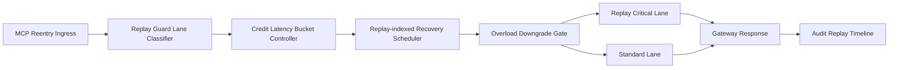

# APIM MCP 重入回放护栏延迟桶公平选型 FAQ（Cycle 2145）

## 1) 3 分钟结论
- **核心问题：** 重入峰值后缺少回放护栏会导致延迟桶分配争议无法快速复盘。
- **推荐方案：** “回放护栏车道 + 延迟桶配给 + 峰值降档 + 可审计回放索引”闭环。
- **目标：** 在租户公平前提下，保障恢复路径可解释、可复盘、可追责。

## 2) Q1 / Q2 / Q3
### Q1：为什么要引入 replay guard lane？
1) 仅靠实时拦截无法解释历史争抢路径；
2) 回放护栏将关键恢复链路与普通链路分层并记录重入轨迹；
3) 与延迟桶结合可同时治理额度、时效、顺序与追溯。

### Q2：生产分层如何设计？
- **回放护栏层：** 按租户与会话等级划分恢复车道并绑定回放索引；
- **配给层：** 车道内发放延迟桶额度与续租窗口；
- **回收层：** 对超额租约执行窗口化回收与抖振抑制；
- **降档层：** 峰值触发分级降档并进入人工复盘队列。

### Q3：上线判据是什么？
- 无护栏漂移率持续下降；
- 回放车道方差率稳定且可追踪；
- 恢复收益（percentage points）连续窗口可复现。

## 3) 架构图

## 4) 选型矩阵
| 维度 | 统一延迟桶 | Replay Guard Lane + Latency Bucket（推荐） |
|---|---:|---:|
| 关键链路可回放性 | 中 | 高 |
| 跨租户抖振抑制 | 中 | 高 |
| 审计追责可解释性 | 中 | 高 |
| 峰值降档稳定性 | 中 | 高 |
| 实施复杂度 | 中 | 中高 |

## 5) 数据证据与可复算算例（含 n 分母来源）
- 证据文件：
  - `workshops/azure-agent-infra/evidence/cycle-2145-benchmark.json`
  - `workshops/azure-agent-infra/evidence/cycle-2145-latency.csv`
  - `workshops/azure-agent-infra/evidence/cycle-2145-throughput.csv`
  - `workshops/azure-agent-infra/evidence/cycle-2145-cost.csv`
- 合同键：
  - `percentage_contract.unfenced_reentry_replayguardlane_drift_rate`
  - `percentage_contract.reentry_replayguardlane_variance_rate`
  - `percentage_contract.reentry_replayguardlane_recovery_gain_pts`
- 标签：`measured / synthetic / anonymized_reported`。

## 6) 生产检查清单
- [ ] replay 护栏映射规则可按租户等级重放。
- [ ] 延迟桶授予/续租/回收与回放护栏一致。
- [ ] 峰值降档时关键车道无饥饿。
- [ ] 审计链路可关联策略版本、回放等级与恢复轨迹。
- [ ] FAQ/H5/SVG/7-card/evidence 的 cycle/topic 一致。
