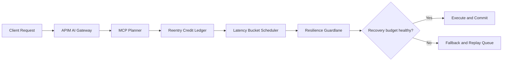

# Agent APIM/MCP Reentry Credit and Latency Bucket Resilience Guardlane FAQ (Cycle 2275)

## 1) Context and constraints
This cycle focuses on resilience guardlane design. APIM AI Gateway, MCP orchestration, reentry-credit ledgers, and latency-bucket scheduling must sustain recoverable behavior through localized faults and burst turbulence.

## 2) Q1 / Q2 / Q3
Q1: How is resilience different from consistency?
A1: Consistency validates converged state; resilience validates sustained recovery under failures and jitter.

Q2: Why must resilience checks include reentry-credit ledgers?
A2: Reentry credit governs retry and fallback budgets, so weak resilience controls amplify tenant contention.

Q3: How can resilience checks remain efficient?
A3: Hot path checks recovery budgets and breaker thresholds, while cold path replays full recovery traces offline.

## 3) Recommendation (Good fit / Not for)
Good fit: multi-tenant SaaS Agent Gateway, Browser/CUA clusters, and high-availability zero-trust execution.
Not for: one-off scripts without SLA, offline micro-experiments, and static tasks without recovery needs.

## 4) Reproducible benchmark scope
Evidence is in `evidence/cycle-2275-benchmark.json`, including cold/warm latency, throughput, policy interception, and per-session cost with measured/synthetic/anonymized_reported labels.

## 5) Percentage contract bindings (N/D)
- `percentage_contract.unfenced_reentry_resilienceguardlane_drift_rate`
- `percentage_contract.reentry_resilienceguardlane_variance_rate`
- `percentage_contract.reentry_resilienceguardlane_recovery_gain_pts`

These keys bind this FAQ to cycle-2275 evidence with `production_validation=not_measured`.

## 6) Production checklist
1. APIM and MCP emit recovery_window and fallback_reason.
2. Reentry-credit writes include recovery_budget and trace_id.
3. Latency-bucket decisions carry recovery-path hash.
4. Budget-exhausted requests route to fallback and replay queues.
5. Replay tooling reconstructs recovery sequences by trace_id.
6. Reports preserve measured/synthetic/anonymized_reported labels.
