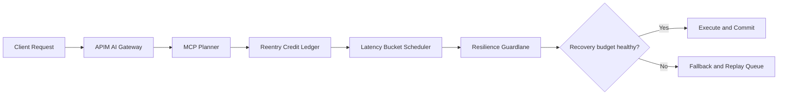

# Agent APIM/MCP 重入信用与延迟桶韧性护栏选型 FAQ（Cycle 2275）

## 1) 场景与约束
本轮聚焦 resilience guardlane（韧性护栏）：在 APIM AI Gateway、MCP 工具编排、重入信用账本与延迟桶调度链路中，要求系统在局部故障、短时突刺和回放补偿阶段持续保持可恢复服务能力。

## 2) Q1 / Q2 / Q3
Q1：韧性护栏与一致性护栏差异？
A1：一致性关注状态是否收敛，韧性关注在故障和抖动下是否能持续恢复并维持服务等级。

Q2：为什么韧性必须覆盖重入信用账本？
A2：重入信用决定回退与重试预算，若无韧性治理会导致故障放大与租户争抢升级。

Q3：如何控制韧性校验的热路径成本？
A3：热路径仅核验恢复预算与熔断阈值，冷路径离线重放全链路恢复过程。

## 3) 选型建议（Good fit / Not for）
Good fit：多租户 SaaS Agent Gateway、Browser/CUA 集群、高可用零信任执行环境。
Not for：无 SLA 的一次性脚本、离线小样本试验、无需故障恢复治理的静态任务。

## 4) 可复现实验范围
实验数据见 `evidence/cycle-2275-benchmark.json`，覆盖冷启动/热恢复 P50/P95、并发吞吐、策略拦截率、单会话成本，并标注 measured/synthetic/anonymized_reported。

## 5) 百分比契约绑定（N/D）
- `percentage_contract.unfenced_reentry_resilienceguardlane_drift_rate`
- `percentage_contract.reentry_resilienceguardlane_variance_rate`
- `percentage_contract.reentry_resilienceguardlane_recovery_gain_pts`

以上键绑定本 FAQ 与 cycle-2275 证据，`production_validation=not_measured`。

## 6) 上线检查单
1. APIM 与 MCP 输出 recovery_window 与 fallback_reason。
2. 重入信用写入记录 recovery_budget 与 trace_id。
3. 延迟桶调度结果附加恢复路径哈希。
4. 预算耗尽请求进入降级与回放队列。
5. 回放工具支持按 trace_id 重建恢复序列。
6. 日报保留 measured/synthetic/anonymized_reported 标签。
