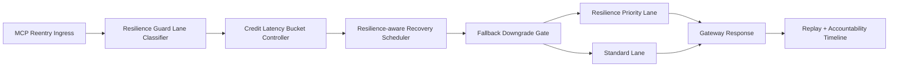

# APIM MCP 重入韧性护栏延迟桶公平选型 FAQ（Cycle 2175）

## 1) 3 分钟结论
- **核心问题：** 重入高峰叠加策略震荡时，韧性不足会触发公平配给抖动与回退放大。
- **推荐方案：** 采用“韧性护栏车道 + 延迟桶信用配给 + 退化旁路 + 回放审计”闭环。
- **目标：** 在多租户公平前提下缩短恢复窗口，并抑制失败传播链路。

## 2) Q1 / Q2 / Q3
### Q1：为什么要引入 resilience guard lane？
1) 统一限流无法按恢复韧性分层，故障会跨租户放大；
2) 韧性护栏可将高波动请求隔离到受控车道；
3) 与延迟桶联动后，可同时约束信用消耗、恢复顺序和失败半径。

### Q2：生产分层如何部署？
- **韧性护栏层：** 基于租户等级与故障签名分配恢复车道；
- **信用配给层：** 车道内实施延迟桶授予、续租、回收；
- **抑制层：** 对突发超额租约执行窗口化回收并阻断扩散；
- **降级层：** 峰值触发旁路降档并保留可追责回放证据。

### Q3：上线门槛是什么？
- 无护栏韧性漂移率持续下降；
- 韧性车道方差率稳定、可解释；
- 恢复收益（percentage points）在多窗口重复可复算。

## 3) 架构图

## 4) 选型矩阵
| 维度 | 统一延迟桶 | Resilience Guard Lane + Latency Bucket（推荐） |
|---|---:|---:|
| 韧性漂移控制 | 中 | 高 |
| 跨租户扩散抑制 | 中 | 高 |
| 回放可追责性 | 中 | 高 |
| 峰值降档稳定性 | 中 | 高 |
| 实施复杂度 | 中 | 中高 |

## 5) 数据证据与可复算算例（含 n 分母来源）
- 证据文件：
  - `workshops/azure-agent-infra/evidence/cycle-2175-benchmark.json`
  - `workshops/azure-agent-infra/evidence/cycle-2175-latency.csv`
  - `workshops/azure-agent-infra/evidence/cycle-2175-throughput.csv`
  - `workshops/azure-agent-infra/evidence/cycle-2175-cost.csv`
- 合同键：
  - `percentage_contract.unfenced_reentry_resilienceguardlane_drift_rate`
  - `percentage_contract.reentry_resilienceguardlane_variance_rate`
  - `percentage_contract.reentry_resilienceguardlane_recovery_gain_pts`
- 标签：`measured / synthetic / anonymized_reported`。

## 6) 生产检查清单
- [ ] resilience 护栏映射可按租户等级回放。
- [ ] 延迟桶授予/续租/回收与韧性护栏策略一致。
- [ ] 峰值降档时韧性优先车道无饥饿现象。
- [ ] 审计链路可关联策略版本、故障签名与恢复路径。
- [ ] FAQ/H5/SVG/7-card/evidence 的 cycle/topic 严格一致。
